# Unstuck — Engineering Specification (docstrings edition)

> **Get unstuck.** Everything the world has tried: what worked, what didn't, and why.
> A global community where everyday experiences, failures, ideas and discoveries become shared knowledge, and where people work together to make things better.

| | |
|---|---|
| Product | **Unstuck** (formerly NegInfo). The name lives in one constant, `settings.PRODUCT_NAME`, so changing it later is one line |
| Version | Spec 2.0, November 2026 |
| Owner | J |
| First build | Spring 2027 semester, Jan 18 – Apr 25, 2027 (v1.0) |
| Budget | $0. Nothing monthly, no GPU |
| Stack | Next.js (TypeScript, server-rendered) · FastAPI (Python 3.12) · Go (`relay`, `live`) · Rust (`intake`, `nh3`) · Postgres 16 + pgvector · Redis 7 · CPU workers (OpenCV, ffmpeg, whisper.cpp, Tesseract, ONNX Runtime, llama.cpp, CTranslate2) · S3-compatible object storage + CDN · Docker Compose on one Oracle Always Free Arm VM |

---

## 0. How to use this file

1. **Read sections 1 to 3 once.** They're the why and the shape.
2. **Section 10 is the code.** Every heading there is a file path. Create the file, paste the docstring and stubs, then implement until the tests in section 17 pass.
3. **IDs connect everything.** `F-07` is a feature, `INV-03` an invariant, `T-12` a required test. Put them in commit messages and test names (`test_INV_03_media_private_until_approved`).
4. **Words.** MUST means a test enforces it. SHOULD means do it unless you write down why not. MAY is optional.
5. **Diagrams** are Mermaid. GitHub renders them. In VS Code, install the *Markdown Preview Mermaid Support* extension, then open the preview (`Ctrl/Cmd + Shift + V`).
6. **Suggested split:** keep this file as `docs/SPEC.md`, and copy section 5 to `db/migrations/0001_init.sql`.

### Contents
1. [Product](#1-product) · 2. [Features](#2-features) · 3. [Architecture](#3-architecture) · 4. [Repository layout](#4-repository-layout) · 5. [Data model](#5-data-model) · 6. [State machines](#6-state-machines) · 7. [API](#7-api-contracts) · 8. [Live events](#8-live-events-sse) · 9. [Jobs](#9-jobs-and-queues) · 10. [Module docstrings](#10-module-docstrings) · 11. [Search and ranking](#11-search-ranking-and-matching) · 12. [AI](#12-ai-models-prompts-and-boundaries) · 13. [Security, privacy and safety](#13-security-privacy-and-safety) · 14. [Config and deployment](#14-configuration-and-deployment) · 15. [Performance](#15-performance-targets-and-caching) · 16. [Observability](#16-observability) · 17. [Tests and evals](#17-tests-and-evals) · 18. [Build plan](#18-build-plan) · 19. [Risks and open questions](#19-risks-and-open-questions)

---

## 1. Product

### 1.1 Positioning

Unstuck is **not** "the place where people post their failures". Failures matter because nobody else shares them, but they are one input among several. Unstuck is where:

- someone **hits a problem** in one part of the world,
- someone **elsewhere contributes what they tried**: a solution, a failure, an idea or a measurement,
- **many people test it in their own context** and report back,
- the community **distills what's known** into living knowledge pages with evidence behind every claim,
- and **thousands of people benefit**, in their own language and on a cheap phone.

It has to be **accessible enough for anyone to contribute** (voice notes, any language, a phone on 3G) and **rigorous enough for serious engineering and science** (data, math, replications, an evidence trail behind every conclusion).

### 1.2 Who it's for

| Persona | Example | What they need |
|---|---|---|
| Everyday person | Fixing a leaking roof in the rainy season | Ask in their own language, see what worked *where they live* |
| Maker or tradesperson | Welder, electrician, mechanic, tailor | Show the job with photos or a short video, get credit, find what failed for others |
| Farmer or food producer | Storing tomatoes without refrigeration | Results by climate, soil and season; voice input; low data |
| Small business owner | Selling online across borders | Practical lessons from others' attempts, pitfalls before starting |
| Software engineer | A migration that broke production | Code, logs, versions, "worked on v3.2, failed on v4" |
| Researcher | An experiment that didn't replicate | Data tables, math, PDFs, DOIs, replications, negative results |
| Teacher or student | Science fair, coursework, teaching | Trustworthy explanations, collections of entries (v1.1) |
| Organization (NGO, lab, company, school) | Running a challenge on a local problem | A space, a challenge, and a summary of what was learned (v1.1) |
| Reviewer or moderator | Trusted community member | Queues, clear rules, explained decisions, appeals |

### 1.3 The knowledge loop

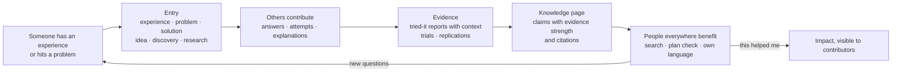

### 1.4 Principles

| # | Principle | What it means in code |
|---|---|---|
| P1 | Anyone can contribute | Voice notes, any language, guided templates, an AI draft the person approves, works on low-end phones |
| P2 | Context is everything | Every entry and every report carries structured context (place, climate, tools, budget, versions). "Works where I am" is a first-class filter |
| P3 | Evidence over votes | Votes order things. Only evidence changes a state. Belief ("the author thinks so") and verification are separate states |
| P4 | Privacy by default, credit by choice | A different alias on every entry, so nothing can be linked. Authors MAY choose to sign an entry |
| P5 | AI assists, people decide | AI drafts, translates, summarizes and finds. It never publishes, confirms, verifies or edits anyone's words |
| P6 | Low-bandwidth first | Readable without JavaScript, images lazy-loaded, a lite mode, a 50 KB budget for text pages |
| P7 | Open knowledge | Openly licensed content, a public read API and data dumps (v1.1), so it outlives the company |
| P8 | Safe in high-stakes areas | Health, electrical, chemical, legal and financial topics get warnings, stricter review, and never read as advice |

### 1.5 Glossary

| Term | Definition |
|---|---|
| **Entry** | The core unit. One of six **kinds**: `experience`, `problem`, `solution`, `idea`, `discovery`, `research` |
| **Outcome** | For experiences, solutions, discoveries and research: `worked`, `failed`, `mixed`, `ongoing` |
| **Template** | Domain-specific fields: `everyday`, `making`, `farming_food`, `software`, `research`, `work_business`, `community` |
| **Context** | Structured key/value facts (country, climate zone, budget band, tools, versions…). Standard keys live in `context_keys` |
| **Link** | A typed relation between entries: `solves`, `next_attempt`, `replicates`, `contradicts`, `builds_on`, `duplicate_of` |
| **Tried-it report** | One account's verdict on an entry, with context: `same_for_me` / `not_for_me` on experiences, `worked_for_me` / `didnt_work_for_me` on solutions, ideas and discoveries |
| **Explanation** | A candidate answer to *why* something failed or worked, on the **Why board**. States: proposed → supported → author-confirmed → independently verified, plus disputed and ruled out |
| **Evidence** | A comment linked to an explanation, with a stance (`supports` / `contradicts`) and a kind (`observation`, `measurement`, `fix_worked`, `fix_failed`, `replication`, `citation`) |
| **Trial** (v1.1) | A structured request: "N people in different contexts, try this and report back with these measurements" |
| **Knowledge page** | A living, community-maintained page on a topic. Every claim cites entries and shows its evidence strength |
| **Challenge** (v1.1) | A framed open problem that gathers entries, trials and a knowledge page |
| **Space** (v1.1) | An organization's home (NGO, lab, school, company) that hosts challenges and collections |
| **Alias** | The public name of an account on one entry, such as `quiet-otter-41`. Different on every entry |
| **Reviewer** | A moderator, or an account with high domain trust that isn't involved in the entry |
| **Helped** | "This helped me" or "this saved me", the impact signal shown to contributors |

### 1.6 Invariants (enforced by tests)

| ID | Invariant |
|---|---|
| INV-01 | No public response, event, page, file or log line contains an account id. Public names come only from `AliasService` |
| INV-02 | Votes never change any state. Only evidence and authorized actions do |
| INV-03 | Media is public only when `review_status = 'approved'`. The CDN reads only the public bucket |
| INV-04 | Counts (tried-it reports, helped, comments) live in Postgres and change in the same transaction as the action |
| INV-05 | Every state change writes a `state_events` row in the same transaction |
| INV-06 | Every job or event a change triggers is written to `outbox_events` in the same transaction as the change |
| INV-07 | Search applies visibility and user filters **inside** candidate retrieval, for both full-text and vector search |
| INV-08 | AI output is labeled, never published on anyone's behalf, never sets an explanation's state, and every summary sentence cites existing sources |
| INV-09 | Translations are labeled as machine-made, and the original text is always one tap away |
| INV-10 | Entries in high-stakes topics show a safety banner and need reviewer approval before they appear in search or feeds |
| INV-11 | Workers are idempotent. Processing the same job twice leaves the same result |
| INV-12 | Nobody can follow a person (that would link aliases). People follow topics, entries, problems, knowledge pages and challenges |
| INV-13 | Live events carry absolute values (current counts and states), never increments |
| INV-14 | Untrusted uploaded bytes are parsed only by the Rust `intake` program. Everything downstream reads its sanitized output. ffprobe/ffmpeg for audio and video are the one sandboxed exception (3.7) |

### 1.7 Scope by release

| Area | v1.0 (spring 2027) | v1.1 (summer 2027) | v2 |
|---|---|---|---|
| Entries | 6 kinds, 7 templates, edit history | Signed entries (opt-in real name) | |
| Media | Images with annotations, 60 s video, video links, PDF, CSV, code, math | Jupyter notebooks, audio entries | |
| Problems | Ask, answers, "solved it for me", stale nudges | Expert matching from contribution history | |
| Evidence | Tried-it reports, Why board, context comparison, attempt chains | **Trials** (distributed testing) | Lab-grade protocols, data dumps per trial |
| Knowledge | Knowledge pages (AI-drafted from patterns, human-maintained), plan check | Collections and learning sets | Citable page versions (DOIs) |
| Reach | 6 interface languages, on-demand translation, voice-to-entry, lite mode | Offline reading (PWA), read aloud | SMS and USSD access |
| Community | Follow topics, notifications, digests, impact | **Challenges**, **Spaces**, Commune link | Grants and bounties |
| Open | CC licenses on every entry | Public read API, weekly data dumps | Federation |
| Safety | Aliases, media review, high-stakes rules, moderation, appeals, internal reputation | Domain trust per topic | |

### 1.8 Relationship to Commune

Unstuck is about **knowing**: what has been tried, the evidence, and what's true where. Commune is about **doing**: projects, tasks and contributions. They share the platform skeleton (section 3). In v1.1, a problem or challenge on Unstuck can link to "Start a project in Commune", and a Commune project can publish what it learned back to Unstuck as entries. Each product keeps its own data and its own identities.

### 1.9 Name

**Unstuck.** It names the moment people arrive (stuck on something) and what they leave with. It works as a verb ("check Unstuck first", "it got me unstuck") and as a promise, and it fits a market trader, a farmer, an engineer and a lab equally well. The knowledge loop maps onto it: stuck → someone who's been there helps → unstuck → the next person never gets stuck.

Before launch: secure the domain and the main social handles, run trademark searches in the US, Ghana and your pilot countries, and say it out loud to French, Swahili and Twi speakers. The name lives in one setting, `settings.PRODUCT_NAME`.

---

## 2. Features

Each feature has an ID, the user stories, acceptance criteria (AC) and its release. AC lines become tests.

### F-01 Entries (v1.0)

*As anyone, I can record what I tried or found, so others don't start from zero.*

- Six kinds share a core: `title`, `goal` (what I was trying to do), `approach` (what I did), `result` (what happened), `outcome`, `why_text` (my best guess, optional), `advice` (what I'd do or avoid next time), `context`, `topics`, `license`, `lang`.
- Per kind:

| Kind | Purpose | Required beyond the core | Outcome |
|---|---|---|---|
| experience | Something I did, and how it went | approach, result | worked / failed / mixed |
| problem | I'm stuck, and here's what I tried | goal, what I tried (approach), constraints | none (has problem state) |
| solution | Something that solved a problem | approach, result, optional `solves` link | worked / mixed |
| idea | Untested idea. "Has anyone tried this?" | approach (the idea), why it might work | none until tested |
| discovery | I noticed something that works better or differently | result, how I noticed | worked / mixed / ongoing |
| research | A study or experiment, including negative results | method, data or results, limitations | worked / failed / mixed |

- Templates add typed fields (`type_fields`), validated by JSON Schema per template.
- AC-01.1: An entry can't publish without the required fields for its kind and template.
- AC-01.2: Edits create a new version. Readers can see the history and what changed.
- AC-01.3: The author chooses a license: CC BY 4.0 (default), CC BY-SA 4.0 or CC0.
- AC-01.4: An **idea** shows a "has this been tried?" panel with the top 5 similar entries before it publishes.

### F-02 Templates (v1.0)

| Template | Extra fields (examples) |
|---|---|
| everyday | materials, cost band, time spent, people involved |
| making | materials, tools, dimensions, process steps, safety notes |
| farming_food | crop or product, variety, season, soil, irrigation, storage, quantities |
| software | language, framework and versions, OS, environment, error output, repro steps, code |
| research | field, hypothesis, method, sample size, data files, analysis, DOI, preregistration link |
| work_business | sector, market or country, team size, budget band, timeline, metric affected |
| community | group size, setting (school, village, online), who was involved, what changed |

### F-03 Context and "works where I am" (v1.0)

*As a reader, I can see whether something worked for people like me, where I am.*

- `context_keys` defines standard keys with types and allowed values: `country`, `region`, `climate_zone` (Köppen group A–E), `season`, `setting` (urban/rural), `budget_band`, `tools_level` (hand/power/industrial), `skill_level`, plus template keys (`os`, `framework_version`, `soil_type`, …).
- Readers set **my context** once (all optional, stored in account settings, never public).
- AC-03.1: Search and lists have a **Works where I am** toggle that re-ranks by context similarity (section 11.4).
- AC-03.2: Every entry shows **context comparison**: a table of the context values where it worked vs. where it failed, with the biggest differences highlighted.
- AC-03.3: A context value shared by fewer than 5 reports is shown only as "few reports", never as a percentage.

### F-04 Rich media and research rendering (v1.0)

| Format | Limits | Processing | Rendered as |
|---|---|---|---|
| Photos (JPEG, PNG, WebP; HEIC in v1.1) | 8 per entry, 15 MB each | Parsed and re-encoded by the Rust `intake` (pixels only, so metadata is gone), optional face and plate blur, WebP at 320/960/1600 px, OCR | Gallery with an annotation layer (arrows, circles, labels) |
| Short video (MP4, WebM, MOV) | 60 s, 100 MB | Metadata stripped, 720p and 360p H.264, poster frame, captions (whisper.cpp) | Player with "the moment it broke / worked" markers |
| Video link | Allowlisted hosts | oEmbed through the SSRF-safe fetcher | Embedded player |
| PDF | 20 MB | Metadata stripped, text extracted, thumbnails | PDF.js viewer |
| CSV | 5 MB, 50k rows | Type inference, summary stats | Sortable table + chart (line, bar, scatter) |
| Code and logs | 200 KB | | Syntax highlighting, diff view |
| Math | | | KaTeX |
| Citations | | DOI lookup through the safe fetcher | Formatted citation + BibTeX export |

- AC-04.1: Every image needs alt text before publishing (an AI suggestion is offered, and the person confirms it).
- AC-04.2 (INV-03): Nothing uploaded is public before approval.

### F-05 Links and attempt chains (v1.0)

- Typed links: `solves` (solution → problem), `next_attempt` (attempt n → n+1), `replicates`, `contradicts`, `builds_on`, `duplicate_of`.
- AC-05.1: An attempt chain renders as a timeline: attempt 1 → 2 → 3, with *what changed* and the outcome of each.
- AC-05.2: `duplicate_of` needs a reviewer and merges stats into the target (the original stays readable).

### F-06 Problems: ask the world (v1.0)

*As someone who's stuck, I can describe my problem and what I've tried, and get help from people who've faced it.*

- A problem has its own state: `open → answered → solved`, or `stale` after 30 days without activity (section 6).
- Answers are comments of type `answer`, or linked `solution` entries.
- The asker marks "**this solved it for me**" on an answer or solution, which sets the problem to solved. Others can add "solved it for me too" reports with their context.
- On posting, the problem is matched to similar solved problems and solutions (shown immediately) and announced to followers of its topics.
- AC-06.1: A problem shows "already solved elsewhere?" with the top 3 matches before it publishes.
- AC-06.2: An unanswered problem is re-surfaced in its topic's feed at 3 and 10 days, and the asker gets a nudge to add detail at 7 days.

### F-07 Tried-it reports (v1.0)

- One per account per entry (`outcome_reports`), with a verdict and optional context and note.
- Allowed verdicts depend on kind: experience and research → `same_for_me` / `not_for_me`; solution, idea and discovery → `worked_for_me` / `didnt_work_for_me`.
- AC-07.1 (INV-04): The count updates in the same transaction and appears live (INV-13).
- AC-07.2: Reports from accounts younger than 24 h are counted but flagged for the anti-brigading check. A burst of 10+ new-account reports in an hour freezes the public count for review.

### F-08 Why board: explanations and evidence (v1.0)

*As a community, we can work out why something failed or worked, and show how we know.*

- Any `hypothesis` comment can be promoted to an explanation. Evidence comments are linked with a stance and a kind.
- States (section 6.3): proposed → supported → author-confirmed → independently verified, plus disputed and ruled out.
- AC-08.1 (INV-02): Votes only order the board.
- AC-08.2: "Independently verified" needs 2+ `replication` or `fix_worked` supporting items from distinct, non-author accounts at least 7 days old, plus a reviewer.
- AC-08.3: The full history (evidence, state changes, who and why) is visible on every explanation.

### F-09 Trials: test it in many places (v1.1, schema in v1.0)

*As a contributor, I can ask people in different places to try something and report results, so we learn where it works.*

- A trial on a solution, idea or discovery: protocol, what to measure (typed fields), contexts wanted (for example "3 people in climate zone A, 3 in B"), slots, closing date.
- People join, run it, and submit a structured report (outcome, measurements, context, photos). Reports count as `replication` evidence.
- On closing, a summary table by context is generated (numbers, not AI prose), and the subject entry shows "tested in N places".
- AC-09.1: Joined slots never exceed `slots` (the conditional update from Commune's claim logic).
- AC-09.2: The trial summary shows results per context with counts, and hides any context with fewer than 3 reports.

### F-10 Knowledge pages (v1.0)

*As a reader, I can read what's known about a topic without reading 200 entries.*

- A page is made of **claims**. Each claim cites entries and explanations, and shows an **evidence strength**: `anecdotal` (1–2 reports), `consistent` (3+ agreeing reports from 2+ contexts), `tested` (a trial or 2+ replications), `verified` (cites a verified explanation), `contested` (significant contradicting evidence).
- Drafted by AI from a pattern (a cluster of entries), labeled as a draft, then edited by humans. AI sentences without valid citations are dropped (INV-08).
- Anyone can propose a revision. **Maintainers** (2+ per page, chosen from top contributors in the topic) accept or reject it with a note.
- AC-10.1: Every claim has 1+ citations, and evidence strength is computed, never typed by hand.
- AC-10.2: A page shows "what we don't know yet" (open problems and contested claims in the topic).
- AC-10.3: Revisions are kept, diffable and attributed to aliases.

### F-11 Challenges (v1.1)

- A framed problem (for example "Keeping tomatoes fresh for 2 weeks without electricity"), with success criteria, a host (a space or a reviewer), status, and linked entries, trials and a knowledge page.
- AC-11.1: A challenge page shows progress: entries, trials, best-evidence approaches, and open questions.
- AC-11.2: "Start a project in Commune" deep-links with the challenge prefilled.

### F-12 Search and plan check (v1.0)

- **Search** is hybrid (keywords + meaning), multilingual (search in your language, find entries written in others), and filterable by kind, outcome, template, topic, has-media, has-data, and "works where I am".
- **Plan check** (formerly pre-mortem): describe what you're about to do and your context, and get the top risks, what worked for others, and open questions, grouped by explanation and pattern, each linked to its entries.
- AC-12.1 (INV-07): Visibility filters are applied inside retrieval.
- AC-12.2: Plan check results always cite entries, and the optional AI summary may cite only those entries.

### F-13 Read and write in your language (v1.0)

- Interface languages in v1.0: English, French, Portuguese, Spanish, Swahili and Arabic (right-to-left). Strings live in `apps/web/messages/{lang}.json`.
- Entries keep their original language. Readers get an on-demand machine translation, labeled, cached per (entry version, language), with "show original" (INV-09).
- Search is cross-lingual through a multilingual embedding model.
- AC-13.1: Translation never blocks reading: the original renders first, and the translation streams in.
- AC-13.2: Right-to-left layouts pass visual tests.

### F-14 Voice and low-literacy support (v1.0 voice, v1.1 read-aloud)

- **Voice to entry**: record up to 3 minutes. whisper.cpp transcribes it, the draft service structures it into fields, and the person reviews and edits before posting. Audio is deleted after transcription unless attached by choice.
- Read aloud (v1.1): the browser's built-in speech synthesis, no server cost.
- AC-14.1: A voice note in a supported language produces an editable draft with the right kind in 80%+ of the eval set.

### F-15 Low-bandwidth and offline (v1.0 lite, v1.1 offline)

- Server-rendered pages are fully readable with JavaScript off.
- **Lite mode** (automatic when `Save-Data` is on or the connection is 2G/3G, or by choice): no autoplay, image placeholders until tapped, 360p video only.
- Budgets: text page ≤ 50 KB transferred, first contentful paint ≤ 2.5 s on a mid-range Android phone over slow 4G (measured in CI with Lighthouse).
- v1.1: save entries and knowledge pages for offline reading (service worker cache).

### F-16 Identity, anonymity and credit (v1.0)

- Passkeys first, with an email magic link as a fallback. Ten recovery codes are shown once.
- A **different random alias on every entry** (INV-01), consistent within that entry's discussion. The author appears as "Author" on their own entry.
- Reputation is internal (INV-12 also stops following people).
- v1.1: **signed entries**. An author MAY attach a public display name to a specific entry for credit. That links only the entries they choose to sign.

### F-17 Following, feeds and notifications (v1.0)

- Follow topics, entries, problems, knowledge pages and challenges (never people, INV-12).
- Home feed: new entries and solved problems in followed topics, updates on followed items, ranked by freshness and evidence, and diversified (section 11.3).
- Notifications: answers to my problem, new evidence on my entry, an explanation changing state, a trial invitation matching my context, and "your entry helped N people" milestones. In-app + Web Push. Instant, daily digest or off, per type. Sent exactly once (dedupe keys).

### F-18 Impact: "this helped me" (v1.0)

- A one-tap **This helped me** (and **This saved me** with an optional "time, money or materials" note) on entries and knowledge pages.
- Contributors see aggregated impact: "Your entries helped 1,240 people in 37 countries". Countries come only from the optional context people set, and a country is shown only when it has 10+ people.
- AC-18.1: Impact numbers are aggregates with a minimum group size of 10. Nobody can see who was helped.

### F-19 Safety and high-stakes topics (v1.0)

- Topics are tagged `high_stakes` (health, electrical, gas, chemicals, structural, legal, financial, child safety).
- Entries in those topics show a banner ("This is someone's experience, not professional advice"), need reviewer approval before appearing in search and feeds (INV-10), and AI helpers add no advice of their own.
- Blocked: instructions that work as a recipe for weapons, drugs, self-harm or hacking, in any field, transcript or image text.
- Before uploads open to the public: industry hash-matching for child sexual abuse material and a legal reporting process (in the US, to NCMEC).

### F-20 Moderation (v1.0)

- Reports with a reason, a review queue sorted by severity, explained decisions (20+ characters), one appeal per action (a different moderator where possible), and a media review queue.
- Actions: hide, remove, warn, limit, suspend. Every action is logged with its explanation.

### F-21 Reputation (v1.0 global, v1.1 per topic)

- Internal `trust_score` (0.2–3.0) from accepted answers, verified explanations, helpful evidence, and reports upheld against you. It weights votes and gates reviewer rights. Never displayed.
- v1.1: `domain_trust` per topic, so a trusted welder isn't automatically trusted on medicine.

### F-22 Open data and API (v1.1)

- Public read API with API keys and rate limits. Weekly dumps of published entries (JSON Lines, Parquet), with aliases but no account ids, under each entry's license.
- Every entry and page has a stable URL and citation formats (BibTeX, APA).

### F-23 Spaces (v1.1)

- Organizations get a verified space with members, challenges, collections and an impact dashboard. Members' entries stay pseudonymous unless they sign them.

### F-24 Collections and learning sets (v1.1)

- Curated, followable lists of entries and pages ("First-time home renovation", "Failed solar-cell coatings"). Teachers can add questions to make a learning set.

### F-25 AI helpers (v1.0)

| Helper | Input | Output | Boundary |
|---|---|---|---|
| Draft my entry | Story text or voice transcript | Structured draft for the chosen kind | The person edits and approves. Fields not supported by the story stay empty |
| Has this been tried? | An idea or problem | Similar entries (retrieval) | No generated claims |
| Alt-text suggestion | An image | A suggested description | The person confirms |
| Captions, OCR | Video, image, PDF | Text for search and accessibility | Labeled as automatic |
| Translate | Entry, comment or page | Translation | Labeled; original one tap away |
| Why-board summary | A thread | Sentences, each citing comments | Uncited sentences dropped |
| Knowledge page draft | A pattern | Claims with citations | Draft until a maintainer accepts it |
| Plan check summary | Retrieved entries | Short summary | May cite only the retrieved entries |

**Never:** publish for someone, change an explanation's state, verify anything, give medical, legal or financial advice, or edit a person's words without approval.


---

## 3. Architecture

### 3.1 System context

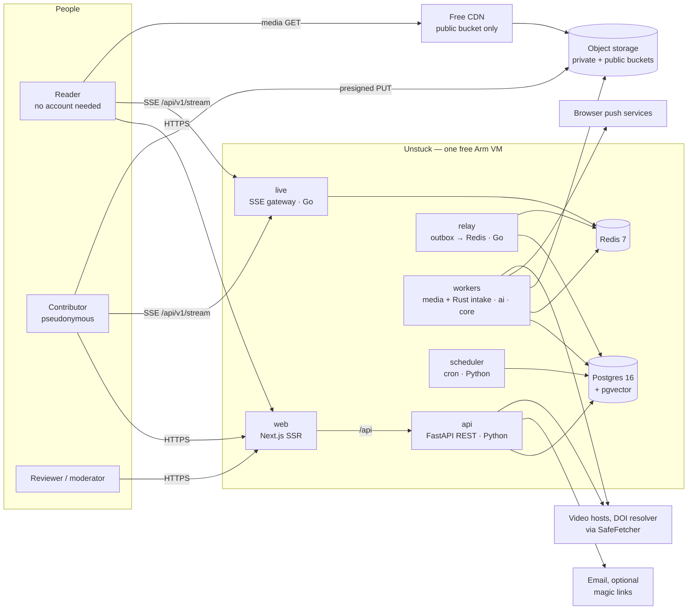

### 3.2 Deployment

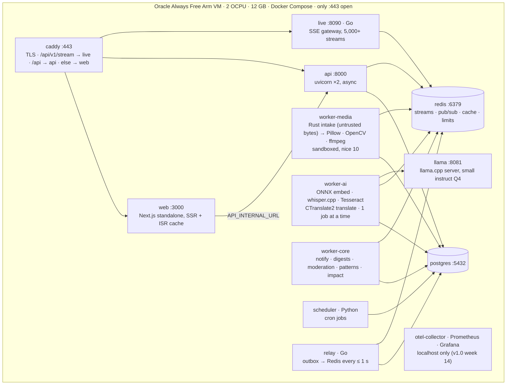

**Network rules:** only caddy is public. postgres and redis have no published ports. worker-media can reach object storage only. SSH is key-only, from your IP. Uploads go from the browser straight to the private bucket.

### 3.3 Layers inside the API

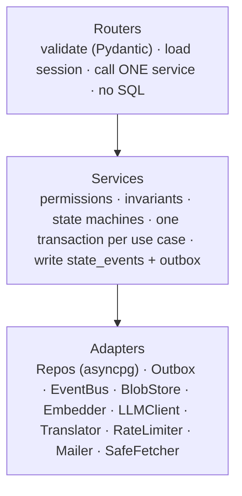

**Rules:** routers call services, and services call adapters. Nothing skips a layer. Services never import FastAPI or SQL. Every adapter has an in-memory fake (`adapters/fakes.py`) used by unit tests and by weeks 1–4 of the build.

### 3.4 Write path (every state change)

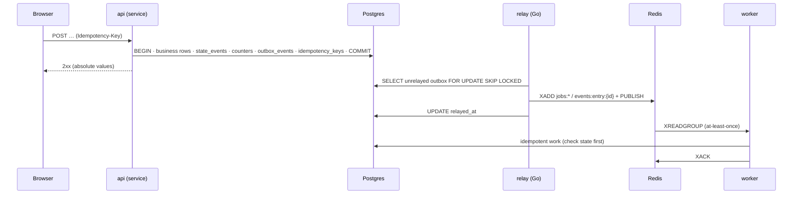

### 3.5 Media path (upload to public)

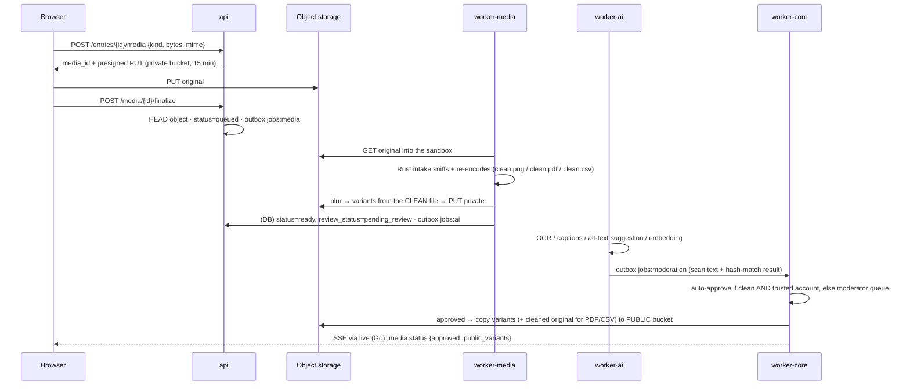

### 3.6 Build order (infrastructure arrives when a feature needs it)

| Weeks | Running | Why |
|---|---|---|
| 1–4 | web, api, postgres. Fakes for BlobStore, EventBus, LLMClient, Translator. `nh3` (Rust sanitizer) from week 4 | Entries, aliases and rendering are code |
| 5–6 | + object storage, redis, the Python fallback relay, worker-media with the Rust `intake` | Images, PDFs, CSVs and video |
| 7 | + llama, worker-ai (drafts, embeddings, voice) | Draft my entry, multilingual search |
| 8 | + caddy on the VM, backups, CI/CD, logs and traces to stdout | Deploy and pilot |
| 9–10 | + Go `relay` (replaces the fallback) and Go `live` (SSE), worker-core (notifications) | Why board, problems, tried-it reports |
| 11 | scheduler pattern jobs, knowledge page drafts | Knowledge pages, plan check |
| 12 | worker-ai adds CTranslate2, Tesseract, captions | Read in your language |
| 13 | media review queue, hash-matching, moderation consumers | Safety before public uploads |
| 14 | otel-collector, Prometheus, Grafana, k6 | Measure targets, launch |

### 3.7 Languages: Python by default, Go for the network, Rust for untrusted bytes

Each language owns the job it's best at, and every boundary between them is a JSON contract (10.27), so any piece can be rewritten without touching the others.

| Language | Owns | Why this language |
|---|---|---|
| **Python 3.12** | API (FastAPI), business rules and state machines, AI glue (llama.cpp, ONNX, whisper.cpp, CTranslate2), media workers after sanitizing, cron jobs | Fastest to build and change. The heavy work happens in C/C++ libraries it calls, so Python isn't the bottleneck |
| **Go 1.23+** | `relay`: moves the outbox into Redis Streams. `live`: the server-sent-events gateway for thousands of open connections. `egress` (v1.1): every outbound fetch (oEmbed, DOI, link previews) | Network-heavy, long-lived connections and fan-out. Goroutines make 5,000+ open streams cheap in memory, it ships as one small static binary, and Caddy, Docker, Kubernetes and Prometheus are all Go |
| **Rust (stable)** | `intake`: the **only** code that parses untrusted uploaded bytes (images, PDFs, CSVs, container sniffing). Markdown and HTML sanitizing through `nh3`, the Python binding of the Rust `ammonia` sanitizer | Memory safety where attackers control the input. `#![forbid(unsafe_code)]`, fuzzed nightly, and each run is a short-lived process inside the sandbox |
| **TypeScript** | Web app (Next.js) | Server rendering, one language for UI |
| **C/C++ (not ours)** | ffmpeg/ffprobe, whisper.cpp, llama.cpp, Tesseract, OpenCV, Postgres, Redis | Battle-tested. Untrusted media reaches them only inside the worker-media sandbox, and images and PDFs only after `intake` has re-written them |

**INV-14:** Untrusted uploaded bytes are parsed only by `intake` (Rust). Everything downstream reads its sanitized outputs. ffprobe and ffmpeg (audio and video) are the one exception, and they run sandboxed with no network.

**The rule for adding more Go or Rust:** move a piece only when (a) it holds many long-lived connections or fans messages out (→ Go), (b) it parses bytes an attacker controls (→ Rust), or (c) a measurement in week 14 or later shows a CPU hot loop Python can't fix (→ Rust). Business logic stays in one language: Python.

**Safety valve:** the Go `relay` and `live` services implement the same contracts as small Python fallbacks (`scheduler/relay.py` and an SSE route behind `LIVE_FALLBACK=python`). If the Go work slips, the product ships on the fallbacks and Go moves to v1.1 with no other change.

| Candidate | Language | When |
|---|---|---|
| Web Push sender at high volume | Go (inside `egress`) | v1.1, if pushes per minute exceed what worker-core sends comfortably |
| Perceptual image hashing for near-duplicate detection | Rust (inside `intake`) | v1.1 |
| Audio-note validation (decode with `symphonia`) | Rust (inside `intake`) | v1.1 |
| HEIC photos (`libheif`, C) | Sandboxed in worker-media, after an `intake` sniff | v1.1 |
| Search gateway, API rewrite | Not planned | Only if measurements say so |

---

## 4. Repository layout

```text
unstuck/
├── apps/
│   └── web/                          # Next.js 15+, TypeScript, App Router, server-rendered (standalone output)
│       ├── app/[locale]/             # /, /search, /e/[id], /e/[id]/why, /p/[slug] (knowledge page),
│       │                             # /ask, /new, /plan, /t/[topic], /me, /mod, /settings
│       ├── components/               # EntryCard, EntryView, ContextChips, ContextCompare, AttemptChain,
│       │                             # MediaGallery, AnnotationLayer, VideoPlayer, DataTable, Chart,
│       │                             # MathBlock, CodeBlock, PdfViewer, WhyBoard, TriedIt, HelpedButton,
│       │                             # KnowledgePage, ClaimCitations, Composer, VoiceComposer,
│       │                             # TranslateToggle, LiteImage, SafetyBanner
│       ├── lib/                      # api.ts (generated from OpenAPI), sse.ts, i18n.ts, lite.ts, push.ts
│       └── messages/                 # en.json fr.json pt.json es.json sw.json ar.json
├── services/
│   ├── api/
│   │   ├── main.py                   # app factory, middleware, error handlers, OpenAPI
│   │   ├── settings.py               # pydantic-settings; PRODUCT_NAME lives here
│   │   ├── routers/                  # auth, me, entries, media, links, problems, reports_outcome,
│   │   │                             # comments, explanations, trials, pages, search, plan, translate,
│   │   │                             # follows, notifications, helped, moderation, ai   (SSE lives in go/cmd/live)
│   │   ├── services/                 # identity, alias, entries, media, media_review, links, problems,
│   │   │                             # outcomes, discussion, explanations, trials, knowledge, search,
│   │   │                             # plancheck, translation, feeds, notify, impact, moderation,
│   │   │                             # reputation, drafts, safety
│   │   ├── adapters/                 # db.py, repos/, outbox.py, event_bus.py, blob_store.py, embedder.py,
│   │   │                             # llm_client.py, translator.py, rate_limiter.py, mailer.py,
│   │   │                             # safe_fetcher.py, fakes.py
│   │   └── domain/                   # enums.py, models.py, errors.py, permissions.py, states.py,
│   │                                 # templates/ (JSON Schemas), context_keys.py
│   ├── workers/
│   │   ├── runtime.py                # consumer loop: XREADGROUP, retries, XACK, DLQ, tracing
│   │   ├── media/                    # image.py, video.py, pdf.py, csv.py, validate.py
│   │   ├── ai/                       # embed.py, ocr.py, transcribe.py, draft.py, alt_text.py,
│   │   │                             # translate.py, summarize.py, page_draft.py
│   │   └── core/                     # notify.py, digest.py, moderation.py, review.py, patterns.py,
│   │                                 # impact.py, problems.py
│   └── scheduler/                    # cron.py, backups.sh, relay.py (Python fallback for the Go relay)
├── go/                               # Go 1.23+ module: github.com/<you>/unstuck/go
│   ├── cmd/relay/                    # outbox → Redis Streams/pub-sub (10.28)
│   ├── cmd/live/                     # SSE gateway (10.29)
│   ├── cmd/egress/                   # v1.1: SSRF-safe outbound fetch proxy
│   └── internal/                     # outbox, live, auth, contracts (generated), telemetry
├── rust/
│   └── intake/                       # untrusted-file sanitizer CLI (10.30) + fuzz/ targets
├── contracts/                        # JSON Schemas for jobs, events and the intake report (10.27)
├── db/migrations/                    # 0001_init.sql (section 5), then numbered migrations
├── deploy/                           # compose.yaml, Caddyfile, .env.example, restore.md
├── evals/                            # drafts/, search/, plan/, translate/, summaries/, moderation/, voice/
├── tests/                            # unit/, integration/, privacy/, permissions/, chaos/, e2e/, load/
└── docs/SPEC.md                      # this file
```

---

## 5. Data model

### 5.1 Entity relationships

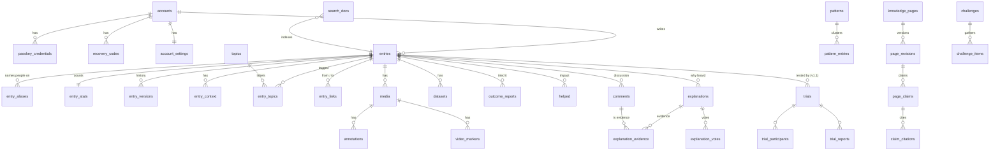

### 5.2 Migration `0001_init.sql`

```sql
-- =====================================================================
-- Unstuck 0001_init.sql · Postgres 16 · pgvector >= 0.8
-- Conventions: uuid PKs, timestamptz, text + CHECK for enums (easy to migrate),
-- every public-facing name comes from entry_aliases (INV-01).
-- =====================================================================
CREATE EXTENSION IF NOT EXISTS vector;
CREATE EXTENSION IF NOT EXISTS citext;
CREATE EXTENSION IF NOT EXISTS pg_trgm;

-- ---------- identity (internal; never exposed) ----------
CREATE TABLE accounts (
  id           uuid PRIMARY KEY DEFAULT gen_random_uuid(),     -- INV-01: never leaves the server
  status       text NOT NULL DEFAULT 'active' CHECK (status IN ('active','limited','suspended','deleted')),
  trust_score  real NOT NULL DEFAULT 1.0 CHECK (trust_score BETWEEN 0.2 AND 3.0),  -- internal
  is_moderator bool NOT NULL DEFAULT false,
  email_enc    bytea,                                          -- optional, encrypted, recovery only
  created_at   timestamptz NOT NULL DEFAULT now()
);
CREATE TABLE passkey_credentials (
  credential_id bytea PRIMARY KEY,
  account_id    uuid NOT NULL REFERENCES accounts(id) ON DELETE CASCADE,
  public_key    bytea NOT NULL, sign_count bigint NOT NULL DEFAULT 0, created_at timestamptz DEFAULT now()
);
CREATE TABLE recovery_codes (account_id uuid REFERENCES accounts(id) ON DELETE CASCADE,
                             code_hash bytea NOT NULL, used_at timestamptz, PRIMARY KEY (account_id, code_hash));
CREATE TABLE magic_link_tokens (token_hash bytea PRIMARY KEY, account_id uuid REFERENCES accounts(id) ON DELETE CASCADE,
                                expires_at timestamptz NOT NULL, used_at timestamptz);
CREATE TABLE sessions (id_hash bytea PRIMARY KEY, account_id uuid NOT NULL REFERENCES accounts(id) ON DELETE CASCADE,
                       created_at timestamptz DEFAULT now(), expires_at timestamptz NOT NULL, revoked_at timestamptz);
CREATE TABLE account_settings (
  account_id     uuid PRIMARY KEY REFERENCES accounts(id) ON DELETE CASCADE,
  ui_lang        text NOT NULL DEFAULT 'en',
  read_langs     text[] NOT NULL DEFAULT '{en}',       -- languages they read without translation
  my_context     jsonb NOT NULL DEFAULT '{}',          -- "works where I am"; never public
  lite_mode      text NOT NULL DEFAULT 'auto' CHECK (lite_mode IN ('auto','on','off')),
  country        text CHECK (country ~ '^[A-Z]{2}$')   -- optional; used only in aggregates of 10+
);

-- ---------- taxonomy ----------
CREATE TABLE topics (
  id          uuid PRIMARY KEY DEFAULT gen_random_uuid(),
  slug        text UNIQUE NOT NULL, parent_id uuid REFERENCES topics(id),
  names       jsonb NOT NULL,                          -- {"en": "Concrete", "fr": "Béton", ...}
  high_stakes bool NOT NULL DEFAULT false              -- INV-10
);
CREATE TABLE context_keys (
  key        text PRIMARY KEY,                         -- 'country', 'climate_zone', 'os', 'soil_type', ...
  labels     jsonb NOT NULL,
  value_type text NOT NULL CHECK (value_type IN ('enum','number','text','country','version')),
  allowed    jsonb,                                    -- enum values or {min,max,unit}
  templates  text[] NOT NULL DEFAULT '{}'              -- empty = all templates
);

-- ---------- entries ----------
CREATE TABLE entries (
  id           uuid PRIMARY KEY DEFAULT gen_random_uuid(),
  author_id    uuid NOT NULL REFERENCES accounts(id),
  kind         text NOT NULL CHECK (kind IN ('experience','problem','solution','idea','discovery','research')),
  template     text NOT NULL CHECK (template IN ('everyday','making','farming_food','software','research','work_business','community')),
  status       text NOT NULL DEFAULT 'draft'
               CHECK (status IN ('draft','pending_review','published','hidden','deleted')),
  outcome      text CHECK (outcome IN ('worked','failed','mixed','ongoing')),
  problem_state text CHECK (problem_state IN ('open','answered','solved','stale')),
  title        text NOT NULL CHECK (length(title) BETWEEN 6 AND 160),
  goal         text NOT NULL,
  approach     text,
  result       text,
  why_text     text,
  advice       text,
  type_fields  jsonb NOT NULL DEFAULT '{}',             -- validated against domain/templates/{template}.json
  lang         text NOT NULL,                          -- BCP-47 of the original
  license      text NOT NULL DEFAULT 'CC-BY-4.0' CHECK (license IN ('CC-BY-4.0','CC-BY-SA-4.0','CC0-1.0')),
  why_status   text NOT NULL DEFAULT 'unknown'
               CHECK (why_status IN ('unknown','suspected','author_confirmed','verified')),
  high_stakes  bool NOT NULL DEFAULT false,            -- copied from topics on publish
  version      int NOT NULL DEFAULT 1,
  created_at   timestamptz NOT NULL DEFAULT now(),
  published_at timestamptz,
  last_activity_at timestamptz NOT NULL DEFAULT now(),
  CHECK ((kind = 'problem') = (problem_state IS NOT NULL)),
  CHECK (kind NOT IN ('experience','research') OR outcome IS NOT NULL OR status = 'draft')
);
CREATE INDEX entries_feed_idx    ON entries (status, published_at DESC);
CREATE INDEX entries_problem_idx ON entries (problem_state, last_activity_at) WHERE kind = 'problem';
CREATE INDEX entries_author_idx  ON entries (author_id);

CREATE TABLE entry_versions (entry_id uuid REFERENCES entries(id) ON DELETE CASCADE, version int NOT NULL,
                             snapshot jsonb NOT NULL, edited_at timestamptz DEFAULT now(), PRIMARY KEY (entry_id, version));
CREATE TABLE entry_context (entry_id uuid REFERENCES entries(id) ON DELETE CASCADE,
                            key text REFERENCES context_keys(key), value text NOT NULL, PRIMARY KEY (entry_id, key));
CREATE INDEX entry_context_kv_idx ON entry_context (key, value);
CREATE TABLE entry_topics  (entry_id uuid REFERENCES entries(id) ON DELETE CASCADE,
                            topic_id uuid REFERENCES topics(id), PRIMARY KEY (entry_id, topic_id));

-- INV-01: a different alias per (entry, account); the author is shown as "Author".
CREATE TABLE entry_aliases (
  entry_id   uuid REFERENCES entries(id) ON DELETE CASCADE,
  account_id uuid REFERENCES accounts(id),
  alias      text NOT NULL,
  PRIMARY KEY (entry_id, account_id), UNIQUE (entry_id, alias)
);
-- v1.1 signed entries: an explicit, per-entry choice to show a display name
CREATE TABLE entry_signatures (entry_id uuid PRIMARY KEY REFERENCES entries(id) ON DELETE CASCADE,
                               display_name text NOT NULL CHECK (length(display_name) BETWEEN 2 AND 60));

-- INV-04: all public counts live here and change in the same transaction as the action
CREATE TABLE entry_stats (
  entry_id      uuid PRIMARY KEY REFERENCES entries(id) ON DELETE CASCADE,
  same_count    int NOT NULL DEFAULT 0, not_same_count int NOT NULL DEFAULT 0,
  worked_count  int NOT NULL DEFAULT 0, didnt_work_count int NOT NULL DEFAULT 0,
  helped_count  int NOT NULL DEFAULT 0, saved_count int NOT NULL DEFAULT 0,
  comment_count int NOT NULL DEFAULT 0, solved_for_count int NOT NULL DEFAULT 0,
  frozen        bool NOT NULL DEFAULT false        -- anti-brigading freeze (AC-07.2)
);

CREATE TABLE entry_links (
  from_id    uuid REFERENCES entries(id) ON DELETE CASCADE,
  to_id      uuid REFERENCES entries(id) ON DELETE CASCADE,
  rel        text NOT NULL CHECK (rel IN ('solves','next_attempt','replicates','contradicts','builds_on','duplicate_of')),
  created_by uuid NOT NULL REFERENCES accounts(id),
  note       text,                                  -- for next_attempt: what changed
  created_at timestamptz DEFAULT now(),
  PRIMARY KEY (from_id, to_id, rel), CHECK (from_id <> to_id)
);
CREATE INDEX entry_links_to_idx ON entry_links (to_id, rel);

-- ---------- media ----------
CREATE TABLE media (
  id            uuid PRIMARY KEY DEFAULT gen_random_uuid(),
  entry_id      uuid REFERENCES entries(id) ON DELETE CASCADE,
  comment_id    uuid,                                -- media can attach to a comment instead
  uploader_id   uuid NOT NULL REFERENCES accounts(id),
  kind          text NOT NULL CHECK (kind IN ('image','video','video_link','pdf','csv','code','audio_note')),
  status        text NOT NULL DEFAULT 'pending' CHECK (status IN ('pending','queued','processing','ready','failed')),
  review_status text NOT NULL DEFAULT 'pending_review' CHECK (review_status IN ('pending_review','approved','rejected')),
  original_key  text,                                -- PRIVATE bucket
  public_prefix text,                                -- set only on approval (INV-03)
  link_url      text,
  variants      jsonb NOT NULL DEFAULT '{}',
  bytes bigint, width int, height int, duration_s real, sha256 bytea,
  alt_text      text,                                -- required for images before publish
  ocr_text text, transcript text, captions_key text,
  metadata_stripped bool NOT NULL DEFAULT false, faces_blurred bool NOT NULL DEFAULT false,
  reviewed_by uuid REFERENCES accounts(id), reviewed_at timestamptz,
  attempts int NOT NULL DEFAULT 0, last_error text, created_at timestamptz DEFAULT now()
);
CREATE INDEX media_entry_idx  ON media (entry_id);
CREATE INDEX media_review_idx ON media (created_at) WHERE review_status = 'pending_review' AND status = 'ready';
CREATE TABLE annotations   (id uuid PRIMARY KEY DEFAULT gen_random_uuid(), media_id uuid REFERENCES media(id) ON DELETE CASCADE,
                            shape text NOT NULL CHECK (shape IN ('arrow','circle','box','label')),
                            coords jsonb NOT NULL, label text);           -- coords normalized 0..1
CREATE TABLE video_markers (id uuid PRIMARY KEY DEFAULT gen_random_uuid(), media_id uuid REFERENCES media(id) ON DELETE CASCADE,
                            at_seconds real NOT NULL CHECK (at_seconds >= 0), label text NOT NULL,
                            kind text NOT NULL DEFAULT 'broke' CHECK (kind IN ('broke','worked','note')));
CREATE TABLE datasets      (id uuid PRIMARY KEY DEFAULT gen_random_uuid(), entry_id uuid REFERENCES entries(id) ON DELETE CASCADE,
                            media_id uuid REFERENCES media(id), columns jsonb NOT NULL, stats jsonb, chart_spec jsonb);

-- ---------- evidence from many people ----------
CREATE TABLE outcome_reports (
  entry_id   uuid REFERENCES entries(id) ON DELETE CASCADE,
  account_id uuid REFERENCES accounts(id),
  verdict    text NOT NULL CHECK (verdict IN ('same_for_me','not_for_me','worked_for_me','didnt_work_for_me','solved_for_me')),
  context    jsonb NOT NULL DEFAULT '{}',
  note       text CHECK (length(note) <= 2000),
  flagged    bool NOT NULL DEFAULT false,            -- new-account / brigading signal
  created_at timestamptz NOT NULL DEFAULT now(),
  PRIMARY KEY (entry_id, account_id)
);
CREATE TABLE helped (
  target_type text NOT NULL CHECK (target_type IN ('entry','page')), target_id uuid NOT NULL,
  account_id  uuid REFERENCES accounts(id),
  kind        text NOT NULL CHECK (kind IN ('helped','saved')),
  saved_note  text CHECK (length(saved_note) <= 280),
  country     text,                                  -- copied from settings at the time; aggregated only
  created_at  timestamptz NOT NULL DEFAULT now(),
  PRIMARY KEY (target_type, target_id, account_id)
);

-- ---------- discussion and the Why board ----------
CREATE TABLE comments (
  id         uuid PRIMARY KEY DEFAULT gen_random_uuid(),
  entry_id   uuid NOT NULL REFERENCES entries(id) ON DELETE CASCADE,
  author_id  uuid NOT NULL REFERENCES accounts(id),
  parent_id  uuid REFERENCES comments(id),
  type       text NOT NULL CHECK (type IN ('reply','question','answer','hypothesis','evidence','fix_tried')),
  body_md    text NOT NULL CHECK (length(body_md) <= 10000),
  lang       text NOT NULL,
  fix_outcome text CHECK (fix_outcome IN ('worked','failed','mixed')),   -- for fix_tried
  status     text NOT NULL DEFAULT 'visible' CHECK (status IN ('visible','hidden','deleted')),
  created_at timestamptz NOT NULL DEFAULT now()
);
CREATE INDEX comments_entry_idx ON comments (entry_id, created_at);

CREATE TABLE explanations (
  id               uuid PRIMARY KEY DEFAULT gen_random_uuid(),
  entry_id         uuid NOT NULL REFERENCES entries(id) ON DELETE CASCADE,
  source_comment   uuid UNIQUE REFERENCES comments(id),
  text             text NOT NULL,
  direction        text NOT NULL CHECK (direction IN ('why_failed','why_worked')),
  state            text NOT NULL DEFAULT 'proposed'
                   CHECK (state IN ('proposed','supported','author_confirmed','verified','disputed','ruled_out')),
  prior_state      text,
  author_note      text,
  verified_by      uuid REFERENCES accounts(id), verified_at timestamptz,
  ruled_out_reason text,
  score            real NOT NULL DEFAULT 0,          -- ORDER ONLY (INV-02)
  CHECK (state <> 'ruled_out' OR ruled_out_reason IS NOT NULL),
  CHECK (state <> 'verified'  OR verified_by IS NOT NULL),
  CHECK (state <> 'disputed'  OR prior_state IS NOT NULL),
  CHECK (state <> 'author_confirmed' OR author_note IS NOT NULL)
);
CREATE TABLE explanation_votes (explanation_id uuid REFERENCES explanations(id) ON DELETE CASCADE,
                                account_id uuid REFERENCES accounts(id), weight real NOT NULL,
                                PRIMARY KEY (explanation_id, account_id));
CREATE TABLE explanation_evidence (
  explanation_id uuid REFERENCES explanations(id) ON DELETE CASCADE,
  comment_id     uuid REFERENCES comments(id),
  account_id     uuid NOT NULL REFERENCES accounts(id),
  stance         text NOT NULL CHECK (stance IN ('supports','contradicts')),
  kind           text NOT NULL CHECK (kind IN ('observation','measurement','fix_worked','fix_failed','replication','citation')),
  hidden         bool NOT NULL DEFAULT false,          -- moderators hide; nothing is deleted
  created_at     timestamptz NOT NULL DEFAULT now(),
  PRIMARY KEY (explanation_id, comment_id)
);

-- INV-05: one history table for every state machine
CREATE TABLE state_events (
  id bigserial PRIMARY KEY,
  entity text NOT NULL CHECK (entity IN ('entry','problem','explanation','media','trial','page_revision','report','challenge')),
  entity_id uuid NOT NULL, from_state text, to_state text NOT NULL,
  actor_id uuid, note text, at timestamptz NOT NULL DEFAULT now()
);
CREATE INDEX state_events_entity_idx ON state_events (entity, entity_id, id);

-- ---------- trials (v1.1; schema ready in v1.0) ----------
CREATE TABLE trials (
  id              uuid PRIMARY KEY DEFAULT gen_random_uuid(),
  subject_entry   uuid NOT NULL REFERENCES entries(id) ON DELETE CASCADE,
  created_by      uuid NOT NULL REFERENCES accounts(id),
  title           text NOT NULL, protocol_md text NOT NULL,
  measures        jsonb NOT NULL,                      -- [{"key":"days_fresh","type":"number","unit":"days"}]
  contexts_wanted jsonb NOT NULL DEFAULT '[]',         -- [{"climate_zone":"A","slots":3}]
  slots           int NOT NULL CHECK (slots BETWEEN 1 AND 500),
  joined          int NOT NULL DEFAULT 0,
  status          text NOT NULL DEFAULT 'draft' CHECK (status IN ('draft','open','full','closed','concluded')),
  closes_at       timestamptz NOT NULL,
  CHECK (joined BETWEEN 0 AND slots)
);
CREATE TABLE trial_participants (trial_id uuid REFERENCES trials(id) ON DELETE CASCADE, account_id uuid REFERENCES accounts(id),
                                 status text NOT NULL CHECK (status IN ('joined','reported','withdrawn','expired')),
                                 joined_at timestamptz DEFAULT now(), PRIMARY KEY (trial_id, account_id));
CREATE TABLE trial_reports (id uuid PRIMARY KEY DEFAULT gen_random_uuid(), trial_id uuid NOT NULL REFERENCES trials(id) ON DELETE CASCADE,
                            account_id uuid NOT NULL REFERENCES accounts(id),
                            outcome text NOT NULL CHECK (outcome IN ('worked','failed','mixed')),
                            measurements jsonb NOT NULL, context jsonb NOT NULL, note text,
                            created_at timestamptz DEFAULT now(), UNIQUE (trial_id, account_id));

-- ---------- patterns and knowledge pages ----------
CREATE TABLE patterns (id uuid PRIMARY KEY DEFAULT gen_random_uuid(), topic_id uuid REFERENCES topics(id),
                       label text NOT NULL, centroid vector(384), entry_count int NOT NULL DEFAULT 0, updated_at timestamptz);
CREATE TABLE pattern_entries (pattern_id uuid REFERENCES patterns(id) ON DELETE CASCADE, entry_id uuid REFERENCES entries(id) ON DELETE CASCADE,
                              PRIMARY KEY (pattern_id, entry_id));

CREATE TABLE knowledge_pages (
  id uuid PRIMARY KEY DEFAULT gen_random_uuid(), slug text UNIQUE NOT NULL, topic_id uuid REFERENCES topics(id),
  title text NOT NULL, lang text NOT NULL DEFAULT 'en',
  status text NOT NULL DEFAULT 'draft' CHECK (status IN ('draft','published','archived')),
  current_revision uuid, license text NOT NULL DEFAULT 'CC-BY-SA-4.0',
  source_pattern uuid REFERENCES patterns(id), created_at timestamptz DEFAULT now()
);
CREATE TABLE page_maintainers (page_id uuid REFERENCES knowledge_pages(id) ON DELETE CASCADE,
                               account_id uuid REFERENCES accounts(id), PRIMARY KEY (page_id, account_id));
CREATE TABLE page_revisions (
  id uuid PRIMARY KEY DEFAULT gen_random_uuid(), page_id uuid NOT NULL REFERENCES knowledge_pages(id) ON DELETE CASCADE,
  author_id uuid REFERENCES accounts(id),               -- NULL = AI draft (labeled)
  summary_md text NOT NULL, change_note text,
  state text NOT NULL DEFAULT 'proposed' CHECK (state IN ('proposed','accepted','rejected','superseded')),
  decided_by uuid REFERENCES accounts(id), decided_note text, created_at timestamptz DEFAULT now()
);
CREATE TABLE page_claims (
  id uuid PRIMARY KEY DEFAULT gen_random_uuid(), revision_id uuid NOT NULL REFERENCES page_revisions(id) ON DELETE CASCADE,
  position int NOT NULL, section text NOT NULL CHECK (section IN ('what_works','what_fails','why','open_questions','safety')),
  text_md text NOT NULL,
  strength text NOT NULL CHECK (strength IN ('anecdotal','consistent','tested','verified','contested')),  -- computed
  UNIQUE (revision_id, position)
);
CREATE TABLE claim_citations (claim_id uuid REFERENCES page_claims(id) ON DELETE CASCADE,
                              target_type text NOT NULL CHECK (target_type IN ('entry','explanation','trial')),
                              target_id uuid NOT NULL, PRIMARY KEY (claim_id, target_type, target_id));

-- ---------- challenges and spaces (v1.1) ----------
CREATE TABLE spaces (id uuid PRIMARY KEY DEFAULT gen_random_uuid(), slug text UNIQUE NOT NULL, name text NOT NULL,
                     kind text NOT NULL CHECK (kind IN ('ngo','lab','school','company','community','government')),
                     verified bool NOT NULL DEFAULT false, created_at timestamptz DEFAULT now());
CREATE TABLE space_members (space_id uuid REFERENCES spaces(id) ON DELETE CASCADE, account_id uuid REFERENCES accounts(id),
                            role text NOT NULL CHECK (role IN ('admin','editor','member')), PRIMARY KEY (space_id, account_id));
CREATE TABLE challenges (id uuid PRIMARY KEY DEFAULT gen_random_uuid(), slug text UNIQUE NOT NULL, space_id uuid REFERENCES spaces(id),
                         title text NOT NULL, problem_md text NOT NULL, success_criteria text NOT NULL,
                         status text NOT NULL DEFAULT 'draft' CHECK (status IN ('draft','open','closed','archived')),
                         page_id uuid REFERENCES knowledge_pages(id), opens_at timestamptz, closes_at timestamptz);
CREATE TABLE challenge_items (challenge_id uuid REFERENCES challenges(id) ON DELETE CASCADE,
                              item_type text NOT NULL CHECK (item_type IN ('entry','trial')), item_id uuid NOT NULL,
                              PRIMARY KEY (challenge_id, item_type, item_id));

-- ---------- search, translation, AI cache ----------
CREATE TABLE search_docs (
  doc_type   text NOT NULL CHECK (doc_type IN ('entry','page','challenge')), doc_id uuid NOT NULL,
  lang       text NOT NULL,
  title      text NOT NULL, body text NOT NULL,
  kind text, template text, outcome text, topic_ids uuid[] NOT NULL DEFAULT '{}',
  has_media bool NOT NULL DEFAULT false, has_data bool NOT NULL DEFAULT false,
  context    jsonb NOT NULL DEFAULT '{}',
  searchable bool NOT NULL DEFAULT false,              -- true only while published AND (not high_stakes OR approved)
  tsv        tsvector NOT NULL,                        -- built by worker: original ('simple') + English translation ('english')
  embedding  vector(384),                              -- multilingual model
  updated_at timestamptz NOT NULL DEFAULT now(),
  PRIMARY KEY (doc_type, doc_id)
);
CREATE INDEX search_docs_tsv  ON search_docs USING gin (tsv) WHERE searchable;
CREATE INDEX search_docs_topics ON search_docs USING gin (topic_ids) WHERE searchable;
CREATE INDEX search_docs_hnsw ON search_docs USING hnsw (embedding vector_cosine_ops)
  WITH (m = 16, ef_construction = 64) WHERE searchable;   -- tune from the eval sweep (section 17)

CREATE TABLE translations (
  target_type text NOT NULL CHECK (target_type IN ('entry','comment','page_revision','explanation')),
  target_id uuid NOT NULL, source_version text NOT NULL, lang text NOT NULL,
  fields jsonb NOT NULL,                               -- {"title": "...", "goal": "...", ...}
  model text NOT NULL, created_at timestamptz DEFAULT now(),
  PRIMARY KEY (target_type, target_id, source_version, lang)
);
CREATE TABLE ai_outputs (
  id uuid PRIMARY KEY DEFAULT gen_random_uuid(),
  kind text NOT NULL CHECK (kind IN ('why_summary','plan_summary','page_draft','alt_text','entry_draft')),
  target_type text NOT NULL, target_id uuid NOT NULL, source_version text NOT NULL,
  text_md text NOT NULL, citations jsonb NOT NULL DEFAULT '[]', model text NOT NULL, created_at timestamptz DEFAULT now(),
  UNIQUE (kind, target_type, target_id, source_version)
);

-- ---------- following and notifications (INV-12: no following people) ----------
CREATE TABLE follows (account_id uuid REFERENCES accounts(id) ON DELETE CASCADE,
                      target_type text NOT NULL CHECK (target_type IN ('topic','entry','page','challenge')),
                      target_id uuid NOT NULL, created_at timestamptz DEFAULT now(),
                      PRIMARY KEY (account_id, target_type, target_id));
CREATE INDEX follows_target_idx ON follows (target_type, target_id);
CREATE TABLE notifications (id uuid PRIMARY KEY DEFAULT gen_random_uuid(), account_id uuid NOT NULL REFERENCES accounts(id) ON DELETE CASCADE,
                            type text NOT NULL, payload jsonb NOT NULL, dedupe_key text UNIQUE NOT NULL,
                            created_at timestamptz DEFAULT now(), sent_at timestamptz, read_at timestamptz);
CREATE TABLE notification_settings (account_id uuid REFERENCES accounts(id) ON DELETE CASCADE, type text NOT NULL,
                                    mode text NOT NULL CHECK (mode IN ('instant','daily','off')), PRIMARY KEY (account_id, type));
CREATE TABLE push_subscriptions (id uuid PRIMARY KEY DEFAULT gen_random_uuid(), account_id uuid REFERENCES accounts(id) ON DELETE CASCADE,
                                 endpoint text UNIQUE NOT NULL, p256dh text NOT NULL, auth text NOT NULL);

-- ---------- trust and safety ----------
CREATE TABLE domain_trust (account_id uuid REFERENCES accounts(id) ON DELETE CASCADE, topic_id uuid REFERENCES topics(id),
                           score real NOT NULL DEFAULT 1.0, PRIMARY KEY (account_id, topic_id));      -- v1.1
CREATE TABLE reports (id uuid PRIMARY KEY DEFAULT gen_random_uuid(), reporter_id uuid REFERENCES accounts(id),
                      target_type text NOT NULL, target_id uuid NOT NULL,
                      reason text NOT NULL CHECK (reason IN ('harmful_howto','dangerous_advice','personal_data','harassment',
                                                             'spam','misinformation','copyright','csam','other')),
                      detail text, severity int NOT NULL DEFAULT 2 CHECK (severity BETWEEN 1 AND 4),
                      status text NOT NULL DEFAULT 'open' CHECK (status IN ('open','reviewing','actioned','dismissed','appealed','closed')),
                      created_at timestamptz DEFAULT now());
CREATE TABLE moderation_actions (id uuid PRIMARY KEY DEFAULT gen_random_uuid(), report_id uuid REFERENCES reports(id),
                                 moderator_id uuid REFERENCES accounts(id),
                                 action text NOT NULL CHECK (action IN ('hide','remove','warn','limit','suspend','approve','reject')),
                                 explanation text NOT NULL CHECK (length(explanation) >= 20),
                                 appeal_status text NOT NULL DEFAULT 'none' CHECK (appeal_status IN ('none','pending','upheld','reversed')),
                                 created_at timestamptz DEFAULT now());

-- ---------- reliability ----------
CREATE TABLE outbox_events (id bigserial PRIMARY KEY, stream text NOT NULL, payload jsonb NOT NULL,
                            created_at timestamptz DEFAULT now(), relayed_at timestamptz);
CREATE INDEX outbox_pending ON outbox_events (id) WHERE relayed_at IS NULL;
CREATE TABLE idempotency_keys (account_id uuid NOT NULL, key text NOT NULL, response jsonb NOT NULL,
                               created_at timestamptz DEFAULT now(), PRIMARY KEY (account_id, key));   -- purged after 24 h
```


---

## 6. State machines

Every machine follows one pattern (implemented once in `domain/states.py`):

1. A table of allowed `(from_state, event, role) → to_state` transitions.
2. A conditional `UPDATE … SET state = :to WHERE id = :id AND state = :from`. Zero rows means `InvalidTransition`, which makes double-clicks and retries harmless.
3. A `state_events` row and any outbox rows, in the same transaction (INV-05, INV-06).

### 6.1 Entry

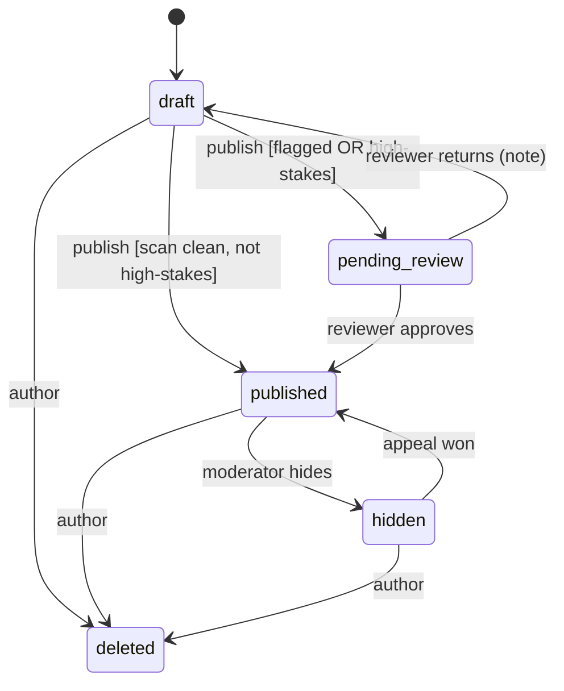

### 6.2 Problem (`entries.problem_state`, only when `kind = 'problem'`)

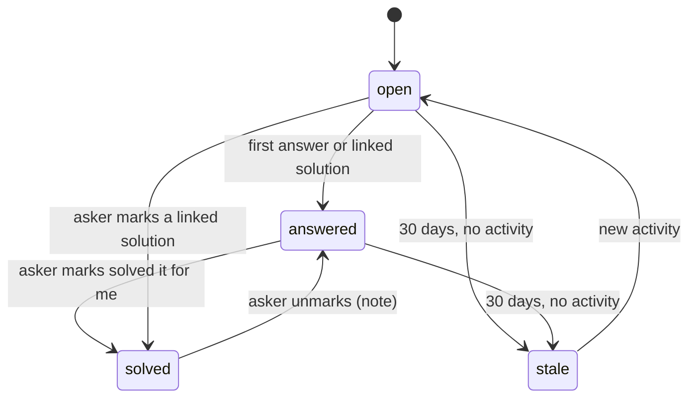

### 6.3 Explanation (the Why board)

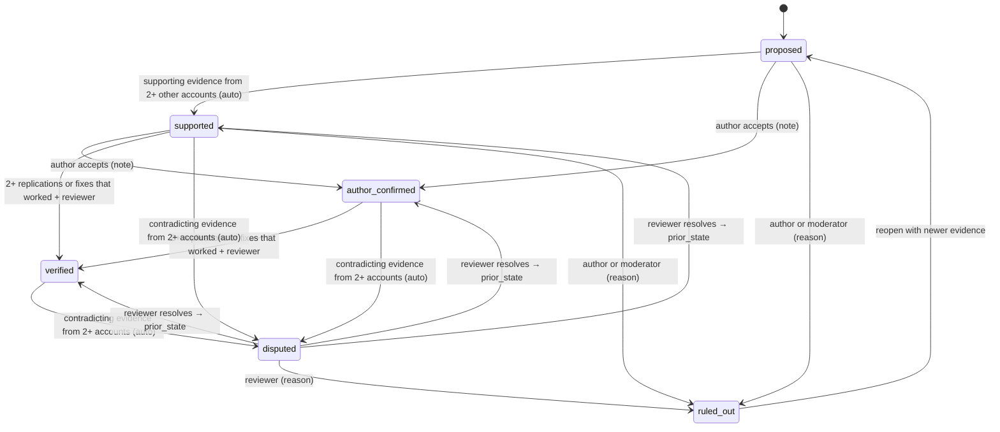

| Rule | Detail |
|---|---|
| Votes | Order only (INV-02) |
| supported | Supporting evidence from 2+ distinct accounts, none of them the entry's author |
| author_confirmed | Records belief, not proof. Shown as "the author's explanation" |
| verified | 2+ supporting `replication` or `fix_worked` items from distinct, non-author accounts at least 7 days old, plus a reviewer who hasn't posted on this entry. Trial reports count as `replication` |
| disputed | Contradicting evidence from 2+ distinct accounts posted after the explanation entered its current state. `prior_state` is saved |
| `entries.why_status` | The best explanation: verified, then author_confirmed, then supported (shown as "suspected"), else unknown. Recomputed in the same transaction |

### 6.4 Media: processing and review are separate

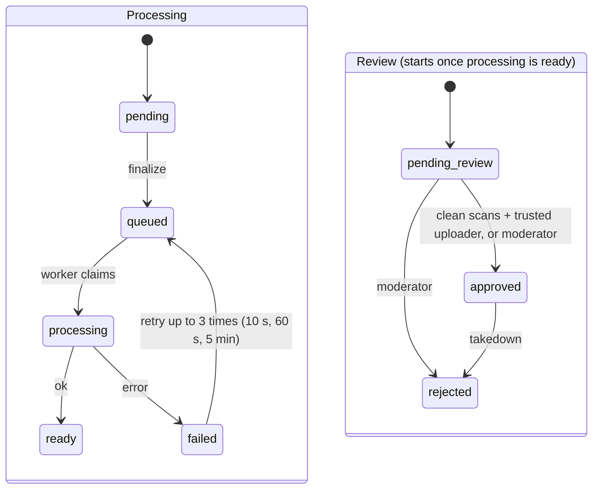

Review starts only when processing reaches `ready` and every scan for that kind has finished. Only `approved` media is copied to the public bucket (INV-03). The 4th processing failure goes to `jobs:media:dlq`.

### 6.5 Trial (v1.1)

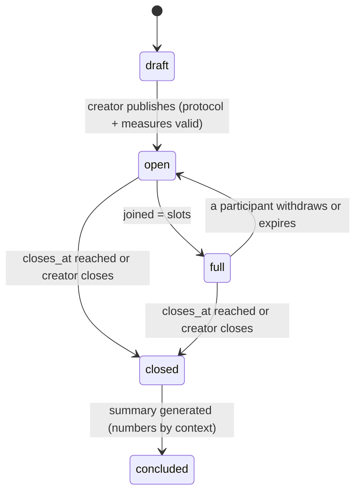

### 6.6 Knowledge page revision

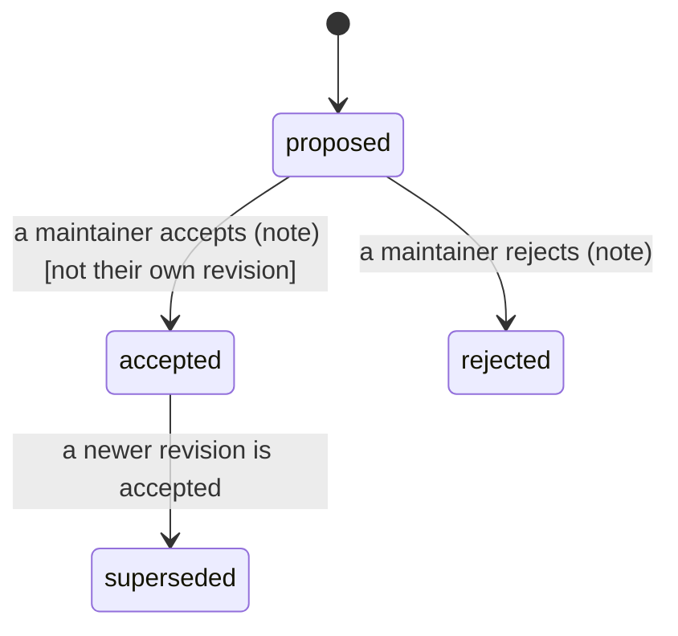

AI drafts enter as `proposed` with `author_id = NULL` and need a maintainer like any other revision. A page with no maintainers yet uses reviewers.

### 6.7 Report and appeal

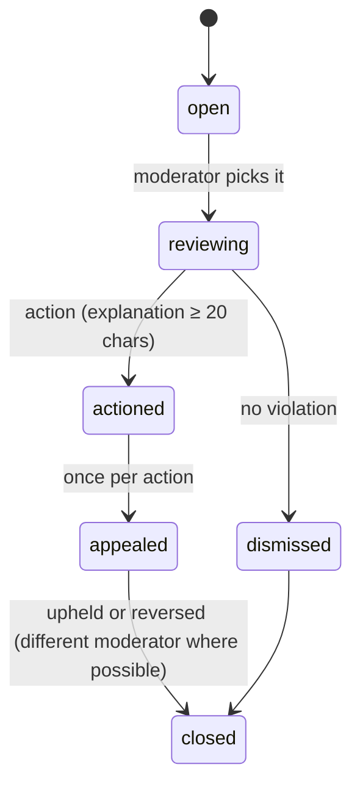

---

## 7. API contracts

### 7.1 Conventions

| Topic | Rule |
|---|---|
| Base | `https://<domain>/api/v1`, JSON over HTTPS. OpenAPI is generated from the routers and committed. The web client is generated from it |
| Auth | Session cookie (HttpOnly, Secure, SameSite=Lax), CSRF token header on cookie-authenticated writes |
| Idempotency | Every create or transition takes `Idempotency-Key`. The first response is stored for 24 h per (account, key) and replayed |
| Concurrency | Edits send `If-Match: <version>`. A stale version returns 412 |
| Pagination | Keyset cursors: `?cursor=<opaque>&limit=` (max 50). `cursor` = base64 of `(sort_value, id)` |
| Errors | RFC 9457 problem details: `{type, title, status, detail, code}`. `code` is a stable machine string such as `entry.invalid_transition` |
| Language | `Accept-Language` picks interface strings. Content comes in its original language plus `translation_available: true` |
| Names | Every person appears as `{alias, is_author, signed_name?}`, never an id (INV-01) |
| Rate limits | Sliding window per route, per account and per IP. 429 with `Retry-After` |
| Live updates | Served by the Go `live` service at `/api/v1/stream/*` on the same origin (Caddy routes it), so cookies and CSP are unchanged |

### 7.2 Endpoints

| Method and path | Who | Limit | Does |
|---|---|---|---|
| `POST /auth/passkey/register/options` · `/verify` | anyone | 10/min/IP | WebAuthn registration. Creates the account and shows 10 recovery codes once |
| `POST /auth/passkey/login/options` · `/verify` | anyone | 10/min/IP | Sign in |
| `POST /auth/magic-link` · `GET /auth/magic-link/{token}` | anyone | 5/h/email | Fallback sign-in. The same response whether or not the email exists |
| `POST /auth/recover` | anyone | 5/h/IP | Recovery code → session, then the person must add a new passkey |
| `POST /auth/logout` | session | | Revoke this session |
| `GET /me` · `PATCH /me/settings` | self | 30/h | Interface language, read languages, my context, lite mode, country |
| `DELETE /me` | self | | Delete the account. Entries stay under their aliases unless "delete my entries" is chosen |
| `POST /entries` | account | 20/h | Create a draft. Body `EntryCreate` |
| `GET /entries/{id}` | anyone | 300/min | `EntryView` (SSR uses this) |
| `PATCH /entries/{id}` | author | 60/h | Edit with `If-Match`. Creates a version |
| `POST /entries/{id}/publish` | author | 20/h | Validate, scan, then published or pending_review |
| `GET /entries/{id}/history` | anyone | | Versions and state events |
| `POST /entries/{id}/links` · `DELETE …/links/{to}/{rel}` | author or reviewer | 60/h | Typed links |
| `GET /entries/{id}/compare` | anyone | | Context comparison (worked vs. failed) |
| `GET /entries/{id}/chain` | anyone | | The attempt chain this entry belongs to |
| `GET /entries/{id}/live` | anyone | 120/min | Snapshot of everything the stream updates. Used after `resync` |
| `POST /entries/{id}/media` | author | 40/h | `{kind, bytes, mime}` → media id + presigned PUT URL (private bucket, 15 min) |
| `POST /media/{id}/finalize` | uploader | 40/h | HEAD the object, then queue processing |
| `POST /media/{id}/annotations` · `/markers` · `PATCH /media/{id}` | uploader | 60/h | Shapes, timestamps, alt text |
| `POST /entries/{id}/reports` | account | 30/h | Tried-it report `{verdict, context, note}`. One per account |
| `POST /entries/{id}/helped` | account | 60/h | `{kind: helped|saved, saved_note?}` (also `POST /pages/{slug}/helped`) |
| `POST /entries/{id}/solved` · `DELETE …/solved` | asker | 10/h | Mark which answer or solution solved the problem |
| `GET /entries/{id}/comments?cursor=` · `POST /entries/{id}/comments` | anyone · account | 30/h | Typed comments |
| `POST /comments/{id}/promote` | account | 10/h | Hypothesis → explanation |
| `PUT /explanations/{id}/vote` | account | 60/h | `{up: bool}`. Weighted. Order only |
| `POST /explanations/{id}/evidence` | account | 30/h | `{comment_id, stance, kind}` |
| `POST /explanations/{id}/author-confirm · /verify · /resolve · /rule-out · /reopen` | author · reviewer · moderator | 30/h | Manual transitions (section 6.3) |
| `POST /trials` · `POST /trials/{id}/join` · `/withdraw` · `/report` · `/close` (v1.1) | account · participant · creator | 10/h | Trials |
| `GET /pages/{slug}` · `GET /pages/{slug}/revisions` | anyone | | Knowledge page, current revision, claims and citations |
| `POST /pages/{slug}/revisions` · `POST /revisions/{id}/accept · /reject` | account · maintainer | 10/h | Propose and decide revisions |
| `GET /search?q=&kind=&outcome=&template=&topic=&media=&data=&near_me=&lang=&cursor=` | anyone | 60/min | Hybrid multilingual search |
| `POST /plan` | anyone | 20/min | Plan check `{plan, context}` |
| `GET /translate/{target_type}/{id}?lang=` | anyone | 60/min | A cached translation, or 202 + SSE `translation.ready` |
| `POST /ai/draft-entry` | account | 10/h | `{text | audio_media_id, kind_hint?, template_hint?}` → `EntryDraft` (never saved) |
| `GET /feed?cursor=` · `GET /topics/{slug}/feed` | account · anyone | 120/min | Home feed and topic feed |
| `POST /follows` · `DELETE /follows/{type}/{id}` | account | 100/h | Topics, entries, pages, challenges only |
| `GET /notifications` · `PATCH /notifications/settings` · `POST /push/subscribe` | self | | Inbox and settings |
| `GET /me/impact` | self | | Aggregates of 10+ only |
| `GET /stream/entry/{id}` · `GET /stream/me` | anyone · self | 5 open/IP | Server-sent events, served by `live` (Go, 10.29) |
| `POST /reports/content` · `GET /mod/queue` · `POST /mod/{report}/action` · `POST /appeals` | account · moderator | 20/h | Trust and safety |
| `GET /mod/media` · `POST /mod/media/{id}/approve · /reject` | moderator | | Media review queue |
| `GET /mod/review` · `POST /mod/entries/{id}/approve · /return` | reviewer | | High-stakes and flagged entries |

### 7.3 Core request and response models

```python
# services/api/domain/models.py  (excerpt; Pydantic v2)

class PersonRef(BaseModel):
    """How a person appears in any public payload (INV-01).

    alias: per-entry random name, e.g. "quiet-otter-41", or "Author".
    is_author: true when this person wrote the entry being viewed.
    signed_name: present only if the author signed this specific entry (v1.1).
    """
    alias: str
    is_author: bool = False
    signed_name: str | None = None


class EntryCreate(BaseModel):
    """Draft creation payload. Kind-specific requirements are enforced at publish, not here,
    so people can save partial drafts.

    context: {context_key: value}; unknown keys are rejected; values validated by context_keys.
    type_fields: validated against domain/templates/{template}.json at publish.
    """
    kind: EntryKind
    template: Template
    title: str = Field(min_length=6, max_length=160)
    goal: str
    approach: str | None = None
    result: str | None = None
    outcome: Outcome | None = None
    why_text: str | None = None
    advice: str | None = None
    lang: str                                  # BCP-47, detected client-side, confirmed by the person
    license: License = License.CC_BY_4
    topics: list[str] = Field(max_length=5)    # topic slugs
    context: dict[str, str] = {}
    type_fields: dict[str, Any] = {}


class EntryView(BaseModel):
    """What GET /entries/{id} returns. Never includes author_id or any account id."""
    id: UUID
    kind: EntryKind; template: Template; status: EntryStatus
    outcome: Outcome | None; problem_state: ProblemState | None
    title: str; goal: str; approach: str | None; result: str | None
    why_text: str | None; advice: str | None
    why_status: WhyStatus
    author: PersonRef
    lang: str; translation_available: bool
    license: License; version: int
    topics: list[TopicRef]; context: dict[str, str]; type_fields: dict[str, Any]
    media: list[MediaView]                      # approved media only, plus the author's own pending previews
    stats: EntryStats                           # absolute counts (INV-04)
    links: list[LinkView]
    high_stakes: bool                           # the UI shows SafetyBanner when true
    published_at: datetime | None


class OutcomeReportCreate(BaseModel):
    """A tried-it report. The allowed verdicts depend on the entry's kind:
    experience, research → same_for_me | not_for_me
    solution, idea, discovery → worked_for_me | didnt_work_for_me
    problem → solved_for_me (only via /solved for the asker; others use it as "solved it for me too")
    """
    verdict: Verdict
    context: dict[str, str] = {}
    note: str | None = Field(default=None, max_length=2000)


class EntryDraft(BaseModel):
    """AI draft. Never persisted by the draft endpoint; the client fills the composer with it.
    missing: fields the story didn't support, so the UI can prompt for them instead of inventing."""
    kind: EntryKind; template: Template
    title: str | None; goal: str | None; approach: str | None; result: str | None
    outcome: Outcome | None; why_text: str | None; advice: str | None
    context: dict[str, str]; type_fields: dict[str, Any]
    missing: list[str]
    lang: str
```

### 7.4 Example: publish a solution that answers a problem

```http
POST /api/v1/entries
Idempotency-Key: 5c0e…
{
  "kind": "solution", "template": "farming_food", "lang": "fr",
  "title": "Conserver les tomates 3 semaines dans un pot-in-pot",
  "goal": "Garder les tomates fraîches sans électricité",
  "approach": "Deux pots en terre cuite, sable mouillé entre les deux, couvert d'un tissu humide",
  "result": "Tomates fermes après 21 jours au lieu de 6",
  "outcome": "worked",
  "topics": ["food-storage"],
  "context": {"country": "BF", "climate_zone": "B", "season": "dry", "budget_band": "under_5_usd"},
  "type_fields": {"product": "tomato", "quantity_kg": 4, "storage_method": "zeer pot"}
}
→ 201 {"id": "e_51…", "status": "draft", "version": 1}

POST /api/v1/entries/e_51…/links   {"to_id": "e_07…", "rel": "solves"}
POST /api/v1/entries/e_51…/publish → 200 {"status": "published"}
```

---

## 8. Live events (SSE)

| Stream | Event | Data (absolute values, INV-13) | When |
|---|---|---|---|
| `entry/{id}` | `stats.updated` | `EntryStats` | Any tried-it, helped or comment count change |
| `entry/{id}` | `comment.created` | `{id, parent_id, type, author: PersonRef, body_html, lang}` | New comment (already sanitized) |
| `entry/{id}` | `explanation.updated` | `{id, state, score, supporting, contradicting}` | Vote, evidence or transition |
| `entry/{id}` | `problem.updated` | `{problem_state, solved_by?: {type, id}}` | Problem state change |
| `entry/{id}` | `media.status` | `{media_id, status, review_status, public_variants?}` | Processing or review progress |
| `entry/{id}` | `summary.ready` | `{kind, html, citations}` | AI summary ready |
| `entry/{id}` | `translation.ready` | `{target_type, target_id, lang}` | Translation cached |
| `me` | `notification.created` | `{id, type, title, url}` | Instant-mode notification |
| any | `resync` | `{}` | `Last-Event-ID` is older than the replay window |

**Replay:** event ids are Redis stream ids. The relay writes each live event to `events:entry:{id}` (MAXLEN ~1000). On reconnect, the `live` gateway (Go) replays everything after `Last-Event-ID`. If that id has been trimmed, it sends `resync`, and the client reloads `GET /entries/{id}/live`.

---

## 9. Jobs and queues

Streams: `jobs:media`, `jobs:ai`, `jobs:notify`, `jobs:index`, `jobs:moderation`, `jobs:core`, each with a consumer group and a `:dlq` twin. Each worker reclaims messages idle more than 5 minutes (`XPENDING … IDLE` then `XCLAIM`, every 30 s), and a message on its 4th delivery goes to `:dlq` instead. The Go `relay` publishes queue-health metrics.

| Job | Payload | Produced by | Consumer | Does | Safe to repeat because (INV-11) |
|---|---|---|---|---|---|
| `media.process` | `{media_id}` | MediaService.finalize | worker-media | Rust `intake` sanitize, then blur, variants (private) and text extraction from the clean file | Returns if status is already `ready` |
| `media.scan` | `{media_id}` | media.process | worker-ai | OCR, captions, alt-text suggestion, hash-match | Results upserted per media |
| `media.review` | `{media_id}` | media.scan | worker-core | Auto-approve or queue (section 10.6) | Conditional state update |
| `media.publish` | `{media_id}` | MediaReviewService.approve | worker-core | Copy to the public bucket, set `public_prefix` | Copying an object twice is harmless |
| `index.upsert` | `{doc_type, doc_id}` | every content write | worker-core | Rebuild the `search_docs` row, then `ai.embed` | Upsert by primary key |
| `ai.embed` | `{doc_type, doc_id, text_hash}` | index.upsert | worker-ai | Multilingual embedding | Skips if text_hash is unchanged |
| `ai.translate` | `{target_type, target_id, source_version, lang}` | TranslationService | worker-ai | Translate, cache | Primary key on version + language |
| `ai.transcribe_voice` | `{media_id, account_id}` | DraftService | worker-ai | whisper.cpp → draft → SSE to the author | Keyed by media id |
| `ai.why_summary` | `{entry_id, last_comment_id}` | scheduler (thread +10) | worker-ai | Cited summary | `ai_outputs` unique key |
| `ai.page_draft` | `{pattern_id}` | scheduler | worker-ai | Draft revision with cited claims | One open AI revision per page |
| `notify.send` | `{account_id, type, payload, dedupe_key}` | services | worker-core | In-app + push, or hold for digest | Unique `dedupe_key` |
| `notify.fanout` | `{event, target_type, target_id}` | services | worker-core | One `notify.send` per follower | Dedupe key per (event, account) |
| `notify.digest` | `{account_id, day}` | scheduler | worker-core | Daily digest | Dedupe key `digest:{account}:{day}` |
| `moderation.scan` | `{target_type, target_id}` | publish, comment | worker-core | Rules + classifiers; may hold for review | Result upserted per target |
| `problems.sweep` | `{}` | scheduler (hourly) | worker-core | Resurface at 3 and 10 days, nudge at 7, stale at 30 | Conditional updates, dedupe keys |
| `patterns.rebuild` | `{topic_id}` | scheduler (nightly) | worker-core | Cluster entries, update patterns | Replaces the topic's rows in one transaction |
| `impact.rollup` | `{}` | scheduler (hourly) | worker-core | Milestone notifications ("helped 100 people") | Dedupe key per milestone |
| `stats.recount` | `{}` | scheduler (nightly) | worker-core | Recount `entry_stats` from source rows and alert on drift | Read-compare-alert |
| `brigade.check` | `{entry_id}` | OutcomeService.report | worker-core | 10+ new-account reports in an hour → set `entry_stats.frozen` and open a review (AC-07.2) | Conditional update, dedupe per hour |
| `media.unpublish` | `{media_ids}` | EntryService.delete, MediaReviewService.reject | worker-core | Delete public copies and purge the CDN | Deleting a missing object is a no-op |
| `ai.plan_summary` | `{plan_hash, entry_ids}` | PlanCheckService | worker-ai | Summary citing only the given entries | `ai_outputs` unique key |
| `trials.tick` (v1.1) | `{}` | scheduler (hourly) | worker-core | Close due trials, expire silent participants, conclude | Conditional updates |


---

## 10. Module docstrings

Each heading is a file. Paste the block, keep the docstrings, and replace `...` with code. Signatures are the contract: if you need to change one, update this file first.

### 10.1 `services/api/settings.py`

```python
"""Runtime configuration, loaded once from environment variables (pydantic-settings).

Every tunable number in the spec lives here, so it can change without a deploy
where noted. Nothing else reads os.environ directly.
"""
from pydantic_settings import BaseSettings


class Settings(BaseSettings):
    """All settings. Defaults are safe for local development with the fakes."""
    PRODUCT_NAME: str = "Unstuck"
    BASE_URL: str = "http://localhost:3000"
    DATABASE_URL: str
    REDIS_URL: str | None = None                  # None → in-memory EventBus/queues (weeks 1–4)
    S3_ENDPOINT: str | None = None
    S3_PRIVATE_BUCKET: str = "unstuck-private"
    S3_PUBLIC_BUCKET: str = "unstuck-public"    # the ONLY bucket the CDN can read (INV-03)
    CDN_BASE_URL: str | None = None
    WEBAUTHN_RP_ID: str = "localhost"
    SESSION_DAYS: int = 30
    LLM_URL: str | None = None                    # llama.cpp server
    EMBED_MODEL_PATH: str | None = None           # multilingual, 384-d, ONNX int8
    TRANSLATE_MODEL_DIR: str | None = None        # CTranslate2 model directory
    WHISPER_MODEL_PATH: str | None = None
    UI_LANGS: list[str] = ["en", "fr", "pt", "es", "sw", "ar"]
    HIGH_STAKES_REQUIRE_REVIEW: bool = True       # INV-10
    MEDIA_AUTO_APPROVE_MIN_AGE_DAYS: int = 7
    MEDIA_AUTO_APPROVE_MIN_TRUST: float = 1.0
    UPLOADS_OPEN_TO: str = "pilot"                # "pilot" until hash-matching is live, then "all"
    VERIFY_MIN_REPLICATIONS: int = 2
    VERIFY_MIN_ACCOUNT_AGE_DAYS: int = 7
    REVIEWER_MIN_TRUST: float = 2.0
    PROBLEM_STALE_DAYS: int = 30
    IMPACT_MIN_GROUP: int = 10                    # F-18
    CONTEXT_MIN_REPORTS: int = 5                  # AC-03.3
    FEED_WEIGHTS: dict[str, float] = {"fresh": 0.35, "evidence": 0.25, "helped": 0.2, "topic": 0.2}
```

### 10.2 `services/api/domain/enums.py`

```python
"""Every enum used across the API, mirroring the CHECK constraints in 0001_init.sql.

Rule: if you add a value here, add it to the migration's CHECK in the same PR,
and the other way round. T-01 compares them automatically.
"""
from enum import StrEnum

class EntryKind(StrEnum):
    EXPERIENCE = "experience"; PROBLEM = "problem"; SOLUTION = "solution"
    IDEA = "idea"; DISCOVERY = "discovery"; RESEARCH = "research"

class Template(StrEnum):
    EVERYDAY = "everyday"; MAKING = "making"; FARMING_FOOD = "farming_food"; SOFTWARE = "software"
    RESEARCH = "research"; WORK_BUSINESS = "work_business"; COMMUNITY = "community"

class EntryStatus(StrEnum):
    DRAFT = "draft"; PENDING_REVIEW = "pending_review"; PUBLISHED = "published"; HIDDEN = "hidden"; DELETED = "deleted"

class Outcome(StrEnum):
    WORKED = "worked"; FAILED = "failed"; MIXED = "mixed"; ONGOING = "ongoing"

class ProblemState(StrEnum):
    OPEN = "open"; ANSWERED = "answered"; SOLVED = "solved"; STALE = "stale"

class Verdict(StrEnum):
    SAME_FOR_ME = "same_for_me"; NOT_FOR_ME = "not_for_me"
    WORKED_FOR_ME = "worked_for_me"; DIDNT_WORK_FOR_ME = "didnt_work_for_me"; SOLVED_FOR_ME = "solved_for_me"

class LinkRel(StrEnum):
    SOLVES = "solves"; NEXT_ATTEMPT = "next_attempt"; REPLICATES = "replicates"
    CONTRADICTS = "contradicts"; BUILDS_ON = "builds_on"; DUPLICATE_OF = "duplicate_of"

class ExplanationState(StrEnum):
    PROPOSED = "proposed"; SUPPORTED = "supported"; AUTHOR_CONFIRMED = "author_confirmed"
    VERIFIED = "verified"; DISPUTED = "disputed"; RULED_OUT = "ruled_out"

class EvidenceKind(StrEnum):
    OBSERVATION = "observation"; MEASUREMENT = "measurement"; FIX_WORKED = "fix_worked"
    FIX_FAILED = "fix_failed"; REPLICATION = "replication"; CITATION = "citation"

class ClaimStrength(StrEnum):
    ANECDOTAL = "anecdotal"; CONSISTENT = "consistent"; TESTED = "tested"; VERIFIED = "verified"; CONTESTED = "contested"

ALLOWED_VERDICTS: dict[EntryKind, frozenset[Verdict]] = {
    EntryKind.EXPERIENCE: frozenset({Verdict.SAME_FOR_ME, Verdict.NOT_FOR_ME}),
    EntryKind.RESEARCH:   frozenset({Verdict.SAME_FOR_ME, Verdict.NOT_FOR_ME}),
    EntryKind.SOLUTION:   frozenset({Verdict.WORKED_FOR_ME, Verdict.DIDNT_WORK_FOR_ME}),
    EntryKind.IDEA:       frozenset({Verdict.WORKED_FOR_ME, Verdict.DIDNT_WORK_FOR_ME}),
    EntryKind.DISCOVERY:  frozenset({Verdict.WORKED_FOR_ME, Verdict.DIDNT_WORK_FOR_ME}),
    EntryKind.PROBLEM:    frozenset({Verdict.SOLVED_FOR_ME}),
}
```

### 10.3 `services/api/domain/errors.py`

```python
"""Domain errors. Services raise these; main.py maps them to RFC 9457 responses.

Each error has a stable `code` that clients can switch on. Never put an account id
or internal detail in `detail` (INV-01).
"""

class DomainError(Exception):
    """Base class. status: HTTP status; code: stable machine string."""
    status: int = 400
    code: str = "error"

class NotFound(DomainError):          status, code = 404, "not_found"          # also used instead of 403 where existence is private
class Forbidden(DomainError):         status, code = 403, "forbidden"
class InvalidTransition(DomainError): status, code = 409, "invalid_transition"
class Conflict(DomainError):          status, code = 409, "conflict"           # e.g. already reported, slots full
class StaleVersion(DomainError):      status, code = 412, "stale_version"
class ValidationFailed(DomainError):  status, code = 422, "validation_failed"  # carries field errors
class RateLimited(DomainError):       status, code = 429, "rate_limited"       # carries retry_after
class Unavailable(DomainError):       status, code = 503, "unavailable"        # e.g. LLM circuit open
```

### 10.4 `services/api/domain/states.py`

```python
"""One generic state-machine helper, plus the transition tables for every machine in section 6.

Usage:
    await ENTRY_MACHINE.apply(tx, entity_id, event="publish", actor=actor, note=None,
                              guard_ctx={...})

apply() does, inside the caller's transaction:
  1. Look up (current_state, event) in the table; check the actor's role is allowed.
  2. Run the transition's guard (a pure function of guard_ctx) if it has one.
  3. UPDATE <table> SET <column> = :to WHERE id = :id AND <column> = :from
     → 0 rows: raise InvalidTransition (someone else moved it first).
  4. INSERT state_events (INV-05).
  5. Return (from_state, to_state) so the service can write outbox rows (INV-06).
It never commits; the service owns the transaction.
"""
from dataclasses import dataclass
from typing import Callable, Literal

Role = Literal["author", "asker", "account", "reviewer", "moderator", "maintainer", "system", "creator", "participant"]

@dataclass(frozen=True)
class Transition:
    """One allowed edge. guard returns None if OK, or a reason string for ValidationFailed."""
    frm: str
    event: str
    to: str
    roles: frozenset[Role]
    guard: Callable[[dict], str | None] | None = None
    note_required: bool = False


class StateMachine:
    """A table-driven machine bound to one table and column."""
    def __init__(self, entity: str, table: str, column: str, transitions: list[Transition]) -> None: ...

    def allowed(self, state: str, role_set: set[Role]) -> list[str]:
        """Events this actor may fire from `state`. The UI uses this to show buttons."""

    async def apply(self, tx, entity_id, event: str, actor, roles: set[Role],
                    note: str | None = None, guard_ctx: dict | None = None,
                    to_override: str | None = None) -> tuple[str, str]:
        """Apply `event`. to_override is only for 'resolve' on explanations (→ prior_state).
        Raises InvalidTransition, Forbidden, ValidationFailed."""


ENTRY_MACHINE: StateMachine        # section 6.1
PROBLEM_MACHINE: StateMachine      # section 6.2  (column entries.problem_state)
EXPLANATION_MACHINE: StateMachine  # section 6.3
MEDIA_PROCESSING: StateMachine     # section 6.4  (column media.status)
MEDIA_REVIEW: StateMachine         # section 6.4  (column media.review_status)
TRIAL_MACHINE: StateMachine        # section 6.5
REVISION_MACHINE: StateMachine     # section 6.6
REPORT_MACHINE: StateMachine       # section 6.7
```

### 10.5 `services/api/domain/permissions.py`

```python
"""Who may do what. The matrix below IS the test plan (T-30 walks every cell).

Roles are computed per request and per object:
  author      the entry's author
  asker       the author of a problem entry
  account     any signed-in account in good standing (status 'active')
  reviewer    moderator, OR trust_score >= REVIEWER_MIN_TRUST and NOT the author and
              NOT someone who commented, reported or presented evidence on this entry
  maintainer  in page_maintainers for this page
  moderator   accounts.is_moderator
'limited' accounts can read and report only. 'suspended' can't do anything but read.

| Action                                   | anyone | account | author | reviewer | maintainer | moderator |
|------------------------------------------|:------:|:-------:|:------:|:--------:|:----------:|:---------:|
| read published entries and pages         |   ✓    |    ✓    |   ✓    |    ✓     |     ✓      |     ✓     |
| create entry, comment, report, follow    |        |    ✓    |   ✓    |    ✓     |     ✓      |     ✓     |
| edit / publish / delete own entry        |        |         |   ✓    |          |            |           |
| tried-it report, helped, vote            |        |    ✓    |  ✗ own |    ✓     |     ✓      |     ✓     |
| promote hypothesis, add evidence         |        |    ✓    |   ✓    |    ✓     |     ✓      |     ✓     |
| author-confirm explanation               |        |         |   ✓    |          |            |           |
| verify / resolve explanation             |        |         |        |    ✓     |            |     ✓     |
| rule out explanation                     |        |         |   ✓    |          |            |     ✓     |
| mark solved                              |        |         | ✓ asker|          |            |           |
| accept / reject page revision            |        |         |        | ✓ if page has no maintainers | ✓ not own |     ✓     |
| approve high-stakes entry, link duplicate|        |         |        |    ✓     |            |     ✓     |
| approve / reject media                   |        |         |        |          |            |     ✓     |
| hide, remove, warn, limit, suspend       |        |         |        |          |            |     ✓     |
"""

async def roles_for(actor, obj, repos) -> set[str]:
    """Compute the actor's roles for one object (entry, explanation, page, media, report)."""

def require(roles: set[str], *any_of: str) -> None:
    """Raise Forbidden unless roles intersect any_of."""
```

### 10.6 `services/api/adapters/` (interfaces)

```python
"""Adapters: the only code that touches infrastructure. Each Protocol has a real
implementation and an in-memory fake in adapters/fakes.py with identical behavior
for tests (T-02 runs the same contract tests against both)."""

class Outbox(Protocol):
    async def add(self, tx, stream: str, payload: dict) -> None:
        """INSERT outbox_events inside the caller's transaction (INV-06).
        stream: 'jobs:<name>' for work, 'live:entry:<id>' / 'live:me:<id>' for SSE events."""

class EventBus(Protocol):
    async def subscribe(self, channel: str, last_event_id: str | None) -> AsyncIterator[Event]:
        """Used only by the Python SSE fallback (LIVE_FALLBACK=python) and by tests; the real
        gateway is Go (10.29) with the same behavior: replay from the capped stream after
        last_event_id, then follow pub/sub; if last_event_id is older than the stream's first id,
        yield a single 'resync' event first."""

class BlobStore(Protocol):
    async def presign_put(self, key: str, content_type: str, max_bytes: int, ttl_s: int = 900) -> PresignedPut:
        """Presigned PUT to the PRIVATE bucket only. Bound to key, content type and length."""
    async def head(self, key: str) -> BlobInfo | None: ...
    async def get(self, key: str, *, bucket: Literal["private", "public"]) -> bytes: ...
    async def put(self, key: str, data: bytes, content_type: str, *, bucket: Literal["private", "public"]) -> None: ...
    async def copy_to_public(self, private_key: str, public_key: str) -> None:
        """Server-side copy. Idempotent."""
    async def delete_public(self, prefix: str) -> None:
        """Delete public copies and request a CDN purge for the prefix."""

class Embedder(Protocol):
    def embed(self, texts: list[str], *, kind: Literal["query", "passage"]) -> list[list[float]]:
        """Multilingual 384-d vectors, L2-normalized. 'query'/'passage' prefixes are applied
        here if the model needs them (e5-style). CPU, ONNX Runtime, int8."""

class LLMClient(Protocol):
    async def complete_json(self, prompt: str, schema: dict, *, max_tokens: int, timeout_s: float) -> dict:
        """llama.cpp /completion with a JSON-schema grammar, so output always parses.
        Circuit breaker: 3 timeouts in 60 s → raise Unavailable for 60 s."""

class Translator(Protocol):
    def translate(self, texts: list[str], src: str, tgt: str) -> list[str]:
        """CTranslate2 int8 on CPU. Returns one output per input, same order.
        Raises ValueError for unsupported pairs (the caller falls back to 'no translation')."""

class RateLimiter(Protocol):
    async def hit(self, key: str, limit: int, window_s: int) -> None:
        """Sliding window (Redis sorted set + Lua). Raise RateLimited(retry_after) when over."""

class SafeFetcher(Protocol):
    async def get(self, url: str, *, max_bytes: int = 524_288, timeout_s: float = 2.0) -> FetchResult:
        """SSRF-safe GET: https only, resolve DNS once, reject private/link-local/loopback
        ranges (v4 and v6), pin the resolved IP, no redirects to other hosts, size and time caps."""

class Mailer(Protocol):
    async def send(self, to: str, subject: str, text: str) -> None:
        """SMTP via a free transactional tier. Bodies never include account ids."""
```

### 10.7 `services/api/services/identity.py`

```python
"""Accounts, passkeys, recovery codes, magic links and sessions (F-16).

Design: an account is an internal row with no public identity at all. Public names come
only from AliasService (INV-01). Email is optional and stored encrypted (email_enc).
"""

class IdentityService:
    async def register_passkey(self, attestation: dict, ui_lang: str) -> tuple[Session, list[str]]:
        """Create an account from a WebAuthn attestation.

        Creates accounts + passkey_credentials + account_settings in one transaction,
        and 10 recovery codes (returned once in plain text, stored as sha256).
        Returns the new session and the codes. Rate limit: 10/min/IP.
        """

    async def login_passkey(self, assertion: dict) -> Session:
        """Verify the assertion and its sign_count (reject a counter that went backwards),
        then create a session (30 days, sliding). Raise Forbidden for suspended accounts."""

    async def request_magic_link(self, email: str) -> None:
        """Always returns normally, whether or not the email matches an account,
        so the endpoint can't be used to discover members. Token: 32 random bytes,
        stored as sha256, 15-minute expiry, single use."""

    async def consume_magic_link(self, token: str) -> Session:
        """UPDATE ... SET used_at = now() WHERE token_hash = sha256(token) AND used_at IS NULL
        AND expires_at > now(). 0 rows → NotFound."""

    async def recover(self, code: str) -> Session:
        """Consume one recovery code. The session is flagged 'must_add_passkey'."""

    async def delete_account(self, actor: Account, delete_entries: bool) -> None:
        """Erase email, credentials and settings. If delete_entries, soft-delete them;
        otherwise they remain under their per-entry aliases (still unlinkable)."""
```

### 10.8 `services/api/services/alias.py`

```python
"""Per-entry pseudonyms (INV-01, F-16)."""

class AliasService:
    async def person_ref(self, tx, account_id: UUID, entry_id: UUID) -> PersonRef:
        """The ONLY way to turn an account into something public.

        Returns PersonRef(alias="Author", is_author=True) for the entry's author
        (plus signed_name if the entry is signed). Otherwise SELECT from entry_aliases,
        or INSERT a new alias "<adjective>-<animal>-<2 digits>" from localized word lists,
        retrying on the UNIQUE (entry_id, alias) conflict.
        Serializers receive PersonRef, never account ids; T-20 scans every public
        payload in the e2e suite for UUIDs that belong to accounts.
        """
```

### 10.9 `services/api/services/entries.py`

```python
"""Entries: create, edit, publish, delete, history (F-01, F-02, F-03, F-05)."""

class EntryService:
    async def create_draft(self, actor: Account, data: EntryCreate, idem_key: str) -> EntryView:
        """Create a draft. Light validation only (title length, known topics and context keys),
        so people can save partial work. For problems, problem_state starts NULL until publish.
        One transaction: entries, entry_context, entry_topics, entry_stats (zeros),
        entry_versions(v1), idempotency_keys. Replays the stored response for a reused key."""

    async def edit(self, actor: Account, entry_id: UUID, patch: EntryPatch, if_match: int) -> EntryView:
        """Author only. UPDATE ... WHERE version = if_match → 0 rows: StaleVersion.
        Snapshot the new version into entry_versions. If published: outbox index.upsert,
        and invalidate cached translations by bumping source_version (= version)."""

    async def publish(self, actor: Account, entry_id: UUID) -> EntryView:
        """draft → published | pending_review (ENTRY_MACHINE).

        Checks, in order:
          1. Required fields for the kind (F-01 table) and template JSON Schema (type_fields).
          2. Every image has alt_text; every media item has status 'ready' (review may be pending:
             media still in review shows as "media under review").
          3. Safety scan (SafetyService.scan_entry): blocked → ValidationFailed with reasons;
             flagged → pending_review.
          4. high_stakes = any topic is high-stakes → pending_review when HIGH_STAKES_REQUIRE_REVIEW.
        For problems, sets problem_state = 'open'. Sets published_at, last_activity_at.
        Outbox: index.upsert, moderation.scan, notify.fanout(topic followers, 'new_entry').
        search_docs.searchable becomes true only for 'published' (INV-07, INV-10).
        """

    async def delete(self, actor: Account, entry_id: UUID) -> None:
        """Soft delete (status 'deleted'), remove from search (searchable=false) in the same
        transaction, delete public media copies via outbox media.unpublish."""

    async def history(self, entry_id: UUID) -> EntryHistory:
        """Versions (diffable snapshots) and state_events, names via AliasService."""

    async def compare_context(self, entry_id: UUID) -> ContextComparison:
        """F-03 AC-03.2. Group outcome_reports (and the entry itself) into 'worked' vs 'failed'
        sides by verdict; for each context key, count values per side; rank keys by the
        absolute difference in share. Values with fewer than CONTEXT_MIN_REPORTS reports are
        returned as {"few_reports": true} with no percentages."""


class LinkService:
    async def link(self, actor: Account, from_id: UUID, to_id: UUID, rel: LinkRel, note: str | None) -> None:
        """Create a typed link. Rules:
          solves:        from a solution (or experience with outcome 'worked') to a problem;
                         moves the problem open → answered.
          next_attempt:  both entries by the same author; note (what changed) required;
                         no cycles (checked with a recursive CTE).
          replicates / contradicts: from experience or research; adds the target to the
                         'tested elsewhere' panel.
          duplicate_of:  reviewer only; merges nothing destructively, the target shows both.
        Outbox: live event on both entries, index.upsert on both."""

    async def chain(self, entry_id: UUID) -> list[ChainStep]:
        """Walk next_attempt links both ways (recursive CTE, max depth 20) and return
        ordered steps with what changed and each outcome."""
```

### 10.10 `services/api/services/problems.py`

```python
"""Problems: ask the world (F-06)."""

class ProblemService:
    async def similar_before_posting(self, draft: EntryCreate) -> list[EntryHit]:
        """AC-06.1. Top 3 solved problems and solutions similar to the draft
        (SearchService with kind in {problem(solved), solution}, near_me if context given)."""

    async def mark_solved(self, actor: Account, problem_id: UUID,
                          by: Literal["answer", "solution"], target_id: UUID) -> EntryView:
        """Asker only. answer → a comment of type 'answer' on this problem;
        solution → an entry linked with rel 'solves'. Transition → solved (PROBLEM_MACHINE),
        record an outcome_report(verdict='solved_for_me') for the asker, raise the
        answerer's trust (+0.05, capped), notify the answerer ('your answer solved a problem').
        Outbox: problem.updated live event, index.upsert (solved problems rank higher)."""

    async def unmark_solved(self, actor: Account, problem_id: UUID, note: str) -> EntryView:
        """solved → answered, note required."""

    async def sweep(self, now: datetime) -> SweepResult:
        """Hourly (job problems.sweep). For open/answered problems:
          day 3 and day 10 without an accepted answer → resurface in topic feeds (feed boost flag);
          day 7 → nudge the asker to add detail (dedupe 'problem_nudge:{id}');
          PROBLEM_STALE_DAYS without activity → stale.
        Every step is a conditional update or a dedupe-keyed notification, so it is safe to run twice."""
```

### 10.11 `services/api/services/outcomes.py`

```python
"""Tried-it reports and impact (F-07, F-18). Counts follow INV-04 and INV-13."""

class OutcomeService:
    async def report(self, actor: Account, entry_id: UUID, data: OutcomeReportCreate) -> EntryStats:
        """One report per account per entry.

        Validates data.verdict against ALLOWED_VERDICTS[entry.kind] (solved_for_me on a problem
        means "solved it for me too" for non-askers). Authors can't report on their own entry.
        One transaction:
          INSERT outcome_reports ... ON CONFLICT (entry_id, account_id) DO NOTHING
          if inserted: UPDATE entry_stats SET <verdict>_count = <verdict>_count + 1 RETURNING *
                       flagged = account younger than 24 h
                       INSERT outbox live:entry:{id} 'stats.updated' with the absolute stats
                       INSERT outbox jobs:core 'brigade.check' {entry_id}
        Returns the absolute stats. Changing your verdict is a delete + insert in one transaction.
        """


class ImpactService:
    async def helped(self, actor: Account, target: tuple[str, UUID], kind: Literal["helped", "saved"],
                     saved_note: str | None) -> EntryStats | PageStats:
        """One per account per target. Same transaction pattern as report().
        Copies account_settings.country at the time (nullable)."""

    async def my_impact(self, actor: Account) -> Impact:
        """Totals of helped/saved across the actor's entries and accepted page revisions,
        countries with >= IMPACT_MIN_GROUP people only, top 5 entries by helped.
        Never returns who was helped."""
```

### 10.12 `services/api/services/discussion.py` and `explanations.py`

```python
"""Comments and the Why board (F-08). See section 6.3 for the machine."""

class DiscussionService:
    async def post(self, actor: Account, entry_id: UUID, data: CommentCreate, idem_key: str) -> CommentView:
        """Render Markdown (markdown-it-py) and sanitize the HTML with nh3, the Python binding of the
        Rust ammonia sanitizer (allowlist; KaTeX and code fences kept),
        detect lang, insert, bump entry_stats.comment_count and entries.last_activity_at,
        problem answered if type == 'answer' and the problem is open.
        Outbox: live 'comment.created' (author as PersonRef), notify (entry followers,
        the parent's author), moderation.scan."""


class ExplanationService:
    async def promote(self, actor: Account, comment_id: UUID) -> ExplanationView:
        """A 'hypothesis' comment becomes an explanation in state 'proposed'.
        direction = 'why_failed' if the entry's outcome is failed/mixed or kind is problem,
        else 'why_worked'. One explanation per comment (UNIQUE source_comment)."""

    async def vote(self, actor: Account, explanation_id: UUID, up: bool) -> ExplanationView:
        """Upsert a vote weighted clamp(trust_score, 0.2, 3.0) (negative if not up), and recompute
        score = sum(weights) + 0.5 * supporting_evidence - 0.5 * contradicting_evidence.
        The author of the entry can't vote. Never changes state (INV-02)."""

    async def add_evidence(self, actor: Account, explanation_id: UUID, comment_id: UUID,
                           stance: Literal["supports", "contradicts"], kind: EvidenceKind) -> ExplanationView:
        """Link evidence, then apply automatic transitions:
          proposed → supported when supporting evidence comes from 2+ distinct non-author accounts;
          supported | author_confirmed | verified → disputed when contradicting evidence comes from
          2+ distinct accounts after the current state began (prior_state saved).
        Evidence is never deleted; moderators can only set hidden=true."""

    async def transition(self, actor: Account, explanation_id: UUID,
                         event: Literal["author_confirm", "verify", "resolve", "rule_out", "reopen"],
                         note: str | None) -> ExplanationView:
        """Manual transitions with the guards in section 6.3:
          author_confirm → note required (author_note).
          verify → reviewer; guard: >= VERIFY_MIN_REPLICATIONS supporting items of kind
                   replication|fix_worked from distinct non-author accounts aged
                   >= VERIFY_MIN_ACCOUNT_AGE_DAYS. Sets verified_by, verified_at.
          resolve → reviewer; to_override = prior_state; note required.
          rule_out → author or moderator; reason required.
          reopen → only with evidence created after the rule-out.
        Every transition recomputes entries.why_status in the same transaction and
        publishes 'explanation.updated'. AI can never call this (INV-08)."""
```

### 10.13 `services/api/services/media.py` and `media_review.py`

```python
"""Uploads, processing and review (F-04, INV-03)."""

LIMITS = {"image": 15 * 2**20, "video": 100 * 2**20, "pdf": 20 * 2**20, "csv": 5 * 2**20,
          "code": 200 * 2**10, "audio_note": 10 * 2**20}
MAX_IMAGES_PER_ENTRY = 8

class MediaService:
    async def request_upload(self, actor: Account, entry_id: UUID, kind: str, size: int, mime: str,
                             idem_key: str) -> UploadTicket:
        """Author only; uploads allowed only for UPLOADS_OPEN_TO accounts. Enforce LIMITS,
        the image count and a MIME allowlist. Insert media(status 'pending'). Return a presigned
        PUT to the PRIVATE bucket, key 'orig/{media_id}', 15 minutes."""

    async def finalize(self, actor: Account, media_id: UUID) -> MediaView:
        """HEAD the object (exists, size within limit, content type matches). One transaction:
        status pending → queued, outbox jobs:media media.process. Idempotent for queued or later."""


class MediaReviewService:
    async def auto_review(self, media_id: UUID) -> Literal["approved", "queued"]:
        """Runs after processing is 'ready' AND scans are done (hash-match, image classifier,
        OCR text and transcript through SafetyService). Approve only if every scan is clean AND
        the uploader is >= MEDIA_AUTO_APPROVE_MIN_AGE_DAYS old with trust >= MEDIA_AUTO_APPROVE_MIN_TRUST
        AND the entry isn't high-stakes. Otherwise leave pending_review (moderator queue).
        A hash-match hit: quarantine (rejected), suspend the uploader, open a severity-4 report,
        and follow the legal reporting process — never auto-anything else."""

    async def approve(self, moderator: Account | None, media_id: UUID) -> MediaView:
        """pending_review → approved (MEDIA_REVIEW). Outbox media.publish: copy variants and,
        for PDF/CSV, the metadata-stripped original to the PUBLIC bucket under 'm/{media_id}/',
        set public_prefix, emit media.status with public_variants."""

    async def reject(self, moderator: Account, media_id: UUID, reason: str) -> MediaView:
        """→ rejected from pending_review or approved (takedown). Delete public copies,
        purge the CDN, keep the private original only for the appeal window (30 days)."""
```

### 10.14 `services/api/services/search.py` and `plancheck.py`

```python
"""Hybrid multilingual search (F-12) and plan check. SQL and formulas: section 11."""

class SearchService:
    async def search(self, q: str, filters: SearchFilters, viewer_ctx: dict | None,
                     cursor: str | None, limit: int = 20) -> Page[EntryHit]:
        """1. Embed q with kind='query' (multilingual, so any language finds any language).
        2. One SQL statement (section 11.1): full-text top 50 and HNSW top 50, BOTH filtered
           inside retrieval by searchable = true plus the user filters (INV-07), fused with RRF.
        3. If filters.near_me and viewer_ctx: re-rank top 50 with context similarity (11.4).
        4. Hydrate titles (and cached translations into the viewer's language if present).
        Cached 60 s by sha1(q, filters, near_me bucket). Never returns unpublished content."""


class PlanCheckService:
    async def check(self, plan: str, context: dict[str, str]) -> PlanCheckResult:
        """F-12 plan check.
        Retrieve 100 candidates (SearchService, kinds experience/research/solution/problem).
        Boost by context similarity. Group by explanation (state >= supported) and by pattern.
        Score each group: relevance × log(1 + reports) × strength_weight
          (verified 1.0, author_confirmed 0.8, supported 0.6, none 0.4).
        Return: top 5 risks (what failed and why), top 3 things that worked, open questions
        (unsolved problems in the same pattern), each with entry ids.
        Optionally queue ai.plan_summary that may cite ONLY those ids (INV-08)."""
```

### 10.15 `services/api/services/knowledge.py`

```python
"""Knowledge pages (F-10)."""

STRENGTH_RULES = """
anecdotal  : 1–2 supporting entries/reports
consistent : 3+ agreeing reports from 2+ distinct context values of a key that matters for the topic
tested     : cites a concluded trial, or 2+ 'replicates' links / replication evidence
verified   : cites an explanation in state 'verified'
contested  : contradicting reports >= 1/3 of supporting, or cites a 'disputed' explanation
(contested overrides the others)
"""

class KnowledgeService:
    async def propose_revision(self, actor: Account | None, page_slug: str, draft: RevisionDraft) -> RevisionView:
        """Anyone (or the AI drafter with actor=None) proposes a revision.
        Every claim needs >= 1 citation to a published entry, explanation or trial; uncited
        claims → ValidationFailed (for AI: dropped before saving). Strength is COMPUTED with
        STRENGTH_RULES at save time, never accepted from input."""

    async def decide(self, actor: Account, revision_id: UUID, accept: bool, note: str) -> RevisionView:
        """Maintainer (not the revision's author) or, if the page has none, a reviewer.
        accept: the previous accepted revision → superseded, page.current_revision = this,
        page published if it was a draft. Outbox: notify page followers, index.upsert."""

    async def refresh_strengths(self, page_id: UUID) -> None:
        """Nightly: recompute strengths of the current revision's claims as evidence changes,
        and flag claims that became 'contested' for maintainers."""

    async def nominate_maintainers(self, page_id: UUID) -> list[UUID]:
        """Suggest the top 5 contributors in the page's topic by accepted answers and verified
        evidence; they become maintainers only if they accept (notification with a button)."""
```

### 10.16 `services/api/services/translation.py`

```python
"""Read in your language (F-13, INV-09)."""

class TranslationService:
    async def get_or_queue(self, target_type: str, target_id: UUID, lang: str) -> Translation | None:
        """Return a cached translation for (target, source_version, lang), or queue
        ai.translate and return None (the client shows the original and waits for
        SSE 'translation.ready'). Never translates into the original language.
        Only public, published content is translated."""
```

### 10.17 `services/api/services/feeds.py`, `notify.py`, `drafts.py`, `safety.py`

```python
class FeedService:
    async def home(self, actor: Account, cursor: str | None) -> Page[FeedItem]:
        """Followed topics/entries/pages: new entries, solved problems, explanation state changes,
        accepted page revisions. Score (11.3), keyset paginated, max 2 items per entry per page,
        a 'reason' string on every item (e.g. "New in Food storage, which you follow")."""

class NotifyService:
    async def send(self, account_id: UUID, type: str, payload: dict, dedupe_key: str) -> None:
        """Exactly once from the person's view: INSERT ... ON CONFLICT (dedupe_key) DO NOTHING;
        stop if not inserted. Mode per type: instant → push + live:me; daily → leave for the
        digest; off → in-app only. Payloads use PersonRef only."""

class DraftService:
    async def draft_entry(self, actor: Account, text: str | None, audio_media_id: UUID | None,
                          kind_hint: EntryKind | None) -> EntryDraft:
        """Voice: queue ai.transcribe_voice and return 202; the draft arrives over live:me.
        Text: LLMClient.complete_json with the EntryDraft schema (section 12.3), 30 s timeout.
        Fields the story doesn't support stay null and are listed in `missing`. Never saved."""

class SafetyService:
    async def scan_entry(self, entry: Entry) -> SafetyResult:
        """Rules first (blocklists per language, link and duplicate spam, personal data patterns:
        phone, email, national id formats, exact addresses), then the small classifier.
        Returns blocked (with reasons), flagged, or clean. Personal data found → redaction
        suggestion shown to the author before publish."""
```


### 10.18 `services/workers/runtime.py`

```python
"""Shared consumer loop for every worker process.

run(stream, group, handler, concurrency):
  loop:
    msgs = XREADGROUP GROUP <group> <consumer> COUNT <concurrency> BLOCK 5000 STREAMS <stream> >
    for each msg (bounded by an asyncio.Semaphore(concurrency)):
      with tracer.start_as_current_span(job.name, context=extract(msg.traceparent)):
        try:   await handler(job)                       # MUST be idempotent (INV-11)
               XACK
        except Permanent as e:   record last_error; XACK; XADD <stream>:dlq
        except Exception as e:   leave pending (no XACK) for a retry
  every 30 s (reclaim):
    pending = XPENDING <stream> <group> IDLE 300000 - + 100
    for each p: if p.deliveries >= 4: XADD <stream>:dlq; XACK          # give up after 3 retries
                else: XCLAIM <stream> <group> <me> 300000 p.id → process like a new message
Metrics: job_duration_seconds{kind}, job_failures_total{kind,reason}.
Shutdown: SIGTERM stops reading, waits up to 30 s for in-flight jobs.
"""

class Permanent(Exception):
    """Raise for errors a retry can't fix (unsupported file, validation). Goes straight to the DLQ."""
```

### 10.19 `services/workers/media/image.py`

```python
async def process_image(job: Job, blob: BlobStore, repo: MediaRepo) -> None:
    """Make an uploaded image safe and fast to serve. Variants stay PRIVATE until approval.

    0. If media.status is 'ready' → return (idempotent).
    1. GET orig/{id} from the private bucket into the tmpfs workspace.
    2. run_intake('image', ...) (10.31): the Rust intake sniffs the real type (JPEG, PNG, WebP),
       rejects > 40 megapixels before decoding, decodes under memory limits, applies EXIF
       rotation and writes pixels only to clean.png (metadata_stripped = true). Rejections are
       Permanent. INV-14: nothing below ever opens the original upload.
    3. Pillow opens ONLY clean.png (produced by intake, so trusted input).
    4. Optional face and plate blur (OpenCV DNN face detector on CPU) when the author ticked it.
    5. WebP variants at 320, 960, 1600 px (no upscaling) → PUT private 'var/{id}/w{n}.webp'.
    6. UPDATE media SET status 'ready', variants, width, height, sha256 of the cleaned image.
       Outbox jobs:ai media.scan (OCR, alt-text suggestion, hash-match).
    """
```

### 10.20 `services/workers/media/video.py`

```python
async def process_video(job: Job, blob: BlobStore, repo: MediaRepo) -> None:
    """Transcode a clip of up to 60 seconds on the CPU.

    run_intake('av', ...) first (container sniff and size, in Rust). Then ffprobe, in the sandbox:
    reject (Permanent) if duration > 60 s, more than one video stream, or an
    unknown codec. Then ffmpeg -map_metadata -1 -map_chapters -1 to 720p and 360p H.264
    (-preset veryfast -crf 26), AAC 96k, +faststart, and a poster frame at 1 s.
    nice 10, 5-minute timeout, tmpfs workspace. Outbox jobs:ai media.scan (captions via
    whisper.cpp, then the transcript goes through SafetyService). Review waits for the scan.
    """
```

### 10.21 `services/workers/media/pdf.py` and `csv.py`

```python
async def process_pdf(job: Job, blob: BlobStore, repo: MediaRepo) -> None:
    """run_intake('pdf', ...) (10.30): the Rust intake parses the PDF with lopdf, removes metadata,
    XMP, JavaScript, embedded files, launch and open actions, caps pages, and writes clean.pdf
    (anything it can't parse is rejected). Then, on clean.pdf only: extract text (pdftotext;
    Tesseract OCR for scanned pages) into media.ocr_text and render a first-page thumbnail.
    clean.pdf is the copy media.publish makes public on approval."""

async def process_csv(job: Job, blob: BlobStore, repo: MediaRepo) -> None:
    """run_intake('csv', ...) (10.30): the Rust intake parses in strict mode (max 50k rows,
    100 columns, 64 KB per field, UTF-8), infers column types, computes stats, and writes
    clean.csv (formula-like cells prefixed with ') plus columns.json. Store datasets.columns and
    stats from columns.json. The renderer escapes every cell and never evaluates formulas."""
```

### 10.22 `services/workers/ai/embed.py`, `translate.py`, `transcribe.py`

```python
async def embed_doc(job: Job, repo: SearchRepo, embedder: Embedder) -> None:
    """Embed search_docs.body (title + goal + result + advice, first 512 tokens) with
    kind='passage'. Skip if text_hash is unchanged. Batch size 16. Model: a multilingual
    384-d sentence model (for example multilingual-e5-small) exported to ONNX int8."""

async def translate(job: Job, repo: TranslationRepo, translator: Translator) -> None:
    """Translate the target's public fields into job.lang, sentence by sentence (keeps Markdown,
    code blocks and math untouched by masking them first), store in translations, emit
    'translation.ready'. Skip if a row exists for (target, source_version, lang).
    Model: an openly licensed model that allows commercial use (for example M2M100-418M or
    Opus-MT pairs) through CTranslate2 int8. Do NOT use non-commercial models (NLLB-200 is
    CC BY-NC). Unsupported pair → store nothing; the UI keeps showing the original."""

async def transcribe_voice(job: Job, blob: BlobStore, llm: LLMClient) -> None:
    """whisper.cpp (small or base model, CPU, language auto-detect) → transcript →
    DraftService prompt (section 12.3) → push EntryDraft to live:me:{account}.
    Delete the audio afterwards unless the person chose to attach it."""
```

### 10.23 `services/workers/ai/summarize.py` and `page_draft.py`

```python
async def why_summary(job: Job, repo: Repos, llm: LLMClient) -> None:
    """Summarize a Why-board thread: what's agreed, what's disputed, what's still unknown.
    The prompt numbers comments as [c:<id>]. JSON grammar:
        {"sentences": [{"text": str, "cites": [str, ...]}]}
    Validation (INV-08): drop sentences with no cites or with ids not in this thread;
    if fewer than 2 sentences survive, store nothing. Saved to ai_outputs keyed by
    (entry, last_comment_id). Never states that an explanation is confirmed or verified
    unless its stored state says so (the prompt includes each explanation's state)."""

async def page_draft(job: Job, repo: Repos, llm: LLMClient, knowledge: KnowledgeService) -> None:
    """Draft a knowledge page from a pattern (top 40 entries by evidence, their explanations
    and states). JSON grammar: {"title": str, "claims": [{"section": ..., "text": str,
    "cites": [entry or explanation ids]}]}. Drop uncited claims and invalid ids, then
    KnowledgeService.propose_revision(actor=None, ...) so it enters as a labeled AI draft
    that a maintainer must accept. At most one open AI revision per page."""
```

### 10.24 `services/workers/core/` (notify, digest, review, patterns, impact, problems)

```python
async def fanout(job: Job, repo: Repos, notify: NotifyService) -> None:
    """For an event on a target, find followers (follows_target_idx), skip the actor,
    and call notify.send with dedupe_key f"{event}:{target_id}:{account_id}"."""

async def digest(job: Job, repo: Repos, mailer: Mailer, push: Push) -> None:
    """At each person's local 08:00 (from ui_lang's default zone or settings), gather unsent
    'daily' notifications, render one push (and one email if they have one and opted in).
    Dedupe key digest:{account}:{date}."""

async def rebuild_patterns(job: Job, repo: Repos) -> None:
    """Per topic: HDBSCAN (min_cluster_size 5) on published entry embeddings; label each
    cluster with its most frequent title keywords (c-TF-IDF, no LLM needed). Replace the
    topic's patterns in one transaction. New clusters with 10+ entries and no page →
    queue ai.page_draft."""

async def impact_rollup(job: Job, repo: Repos, notify: NotifyService) -> None:
    """Milestones 10, 100, 1,000, 10,000 helped per entry and per author → one notification
    each (dedupe impact:{entry}:{milestone})."""
```

### 10.25 `services/scheduler/cron.py` and `relay.py` (Python fallback)

```python
async def relay_outbox(db: Pool, redis: Redis, batch: int = 100) -> int:
    """Move committed outbox rows into Redis. At-least-once, by design.

    THE CONTRACT for both implementations: this Python fallback (weeks 5–8, and whenever
    RELAY_IMPL=python) and the Go relay (10.28), which replaces it from week 9. T-04 runs
    against both. Live events use the same atomic XADD+PUBLISH script as the Go version.

    SELECT id, stream, payload FROM outbox_events WHERE relayed_at IS NULL
    ORDER BY id FOR UPDATE SKIP LOCKED LIMIT :batch
    For 'jobs:*' streams: XADD <stream> * payload (with a traceparent).
    For 'live:entry:<id>' / 'live:me:<id>': XADD events:<...> MAXLEN ~ 1000 * payload, then
    PUBLISH the same message on channel <...> for connected SSE handlers.
    UPDATE outbox_events SET relayed_at = now() WHERE id = ANY(:ids).
    A crash between XADD and UPDATE re-sends rows: consumers are idempotent (INV-11) and live
    events carry absolute values (INV-13). Runs every second. Purges rows relayed > 7 days ago."""

CRON = {
    "0 * * * *":   ["problems.sweep", "impact.rollup", "trials.tick"],
    "15 3 * * *":  ["patterns.rebuild", "stats.recount", "knowledge.refresh_strengths",
                    "purge_idempotency_keys", "purge_expired_sessions"],
    "30 2 * * *":  ["backup_postgres"],      # pg_dump → encrypted → off-server copy, keep 14
}
```

### 10.26 `apps/web` (TypeScript)

```ts
/**
 * lib/sse.ts — live updates for one entry.
 * subscribe(entryId, onEvent): opens EventSource(`/api/v1/stream/entry/${id}`),
 * relies on the browser's automatic Last-Event-ID on reconnect.
 * On 'resync': fetch `/entries/${id}/live` and replace local state wholesale.
 * Every event payload is absolute (INV-13): always replace, never add.
 * Closes the stream when the tab is hidden for > 60 s (saves data on mobile), reopens on focus.
 */

/**
 * lib/lite.ts — lite mode (F-15).
 * isLite(): true if settings.lite_mode === 'on', or 'auto' and
 * (navigator.connection?.saveData || effectiveType in {'slow-2g','2g','3g'}).
 * In lite mode: <LiteImage> renders a tap-to-load placeholder with alt text, videos use the
 * 360p variant with preload="none", charts render as tables.
 */

/**
 * components/EntryView.tsx — server component. Renders a full entry with JavaScript off.
 * Order: SafetyBanner (if high_stakes) · title · kind/outcome chips · author PersonRef ·
 * TranslateToggle · goal/approach/result/why/advice · ContextChips · MediaGallery ·
 * stats + TriedIt + HelpedButton · links (solves / attempt chain / replicates) ·
 * ContextCompare · WhyBoard (client island) · comments.
 * Never renders anything not in EntryView (no ids beyond the entry's).
 */

/**
 * components/TriedIt.tsx — one button pair chosen by kind (ALLOWED_VERDICTS mirror):
 * experience/research: "Same for me" / "Not for me"; solution/idea/discovery:
 * "Worked for me" / "Didn't work for me". Opens a 3-field context sheet prefilled from
 * my_context (editable, optional). Sends Idempotency-Key; disables until the response.
 */

/**
 * components/WhyBoard.tsx — explanations ordered by score, each with its state badge
 * (proposed · supported · author's explanation · verified · disputed · ruled out),
 * supporting vs contradicting evidence counts, history drawer (state_events), and
 * only the action buttons the API says are allowed for this viewer (StateMachine.allowed).
 */

/**
 * components/VoiceComposer.tsx — MediaRecorder (opus/webm, max 3 min), uploads as
 * kind 'audio_note' via presigned PUT, calls /ai/draft-entry, shows a "transcribing…"
 * state, then fills the Composer with the EntryDraft and highlights `missing` fields.
 */

/**
 * components/KnowledgePage.tsx — claims grouped by section (what works · what fails · why ·
 * open questions · safety), each with a strength chip and citation links. AI-drafted
 * revisions show "Drafted by AI, reviewed by maintainers" with the accepting alias.
 */
```

### 10.27 `contracts/` (shared across Python, Go, Rust and TypeScript)

```text
contracts/
├── jobs/          one JSON Schema per job in section 9   (media.process.json, index.upsert.json, …)
├── events/        one JSON Schema per live event in section 8 (stats.updated.json, comment.created.json, …)
├── intake/        report.json — the Rust intake's stdout contract (10.30)
└── README.md
Codegen (`make contracts`):
  Python      → services/api/domain/contracts.py     (datamodel-code-generator, Pydantic v2)
  Go          → go/internal/contracts/*.go            (go-jsonschema)
  Rust        → rust/intake/src/report.rs is hand-written; a test validates its JSON against report.json
  TypeScript  → apps/web/lib/contracts.ts             (json-schema-to-typescript)
Rules:
  - Every job and event envelope carries "v": 1. Consumers ignore unknown fields.
  - A breaking change publishes "v": 2; consumers handle both until the old version drains.
  - T-44: CI regenerates all bindings and fails if `git diff` isn't empty.
```

### 10.28 `go/cmd/relay` and `go/internal/outbox` (Go)

```go
// Package outbox moves committed rows from Postgres outbox_events into Redis.
// It is the Go implementation of the contract in 10.25; T-04 runs against both.
//
// Delivery is at-least-once by design: a crash after XADD and before the relayed_at
// update re-sends rows. That's safe because every consumer is idempotent (INV-11)
// and every live event carries absolute values (INV-13).
//
// Libraries: github.com/jackc/pgx/v5 (pgxpool), github.com/redis/go-redis/v9,
// go.opentelemetry.io/otel, github.com/prometheus/client_golang.
package outbox

// Config is read from the environment by cmd/relay.
type Config struct {
	DatabaseURL   string        // DATABASE_URL
	RedisURL      string        // REDIS_URL
	Batch         int           // RELAY_BATCH, default 100
	Idle          time.Duration // RELAY_INTERVAL_MS, default 1s; drops to 100ms while rows keep arriving
	EntryStreamMax int64        // ~1000 entries kept in events:entry:<id>
	MeStreamMax   int64         // ~200 entries kept in events:me:<id>
	PurgeAfter    time.Duration // 7 days: delete rows relayed longer ago than this
}

// Run relays until ctx is cancelled. It loops relayOnce, backing off to cfg.Idle when a
// batch comes back empty. Safe to run as 2+ instances (FOR UPDATE SKIP LOCKED).
func Run(ctx context.Context, cfg Config, db *pgxpool.Pool, rdb *redis.Client) error

// relayOnce relays up to cfg.Batch rows and reports how many it moved.
//
//	BEGIN
//	SELECT id, stream, payload FROM outbox_events
//	 WHERE relayed_at IS NULL ORDER BY id LIMIT $1 FOR UPDATE SKIP LOCKED
//	for each row: route(row.stream) → publish (one Redis pipeline for the batch)
//	UPDATE outbox_events SET relayed_at = now() WHERE id = ANY($ids)
//	COMMIT
//
// On a Redis error: ROLLBACK, so the rows are retried on the next tick.
// Metrics: outbox_unrelayed, outbox_relay_lag_seconds, outbox_relayed_total{stream}.
func relayOnce(ctx context.Context, cfg Config, db *pgxpool.Pool, rdb *redis.Client) (int, error)

// route maps an outbox stream name to Redis operations:
//
//	"jobs:<name>"     → XADD jobs:<name> * job <json> traceparent <tp>
//	"live:entry:<id>" → script publishLive(KEYS: events:entry:<id>, live:entry:<id>)
//	"live:me:<id>"    → script publishLive(KEYS: events:me:<id>,    live:me:<id>)
//
// Anything else is a programming error: the row is skipped, logged, and counted.
func route(stream string) (op Op, err error)

// publishLive is a Lua script so the stream id and the PUBLISH happen atomically in one round trip:
//
//	local id = redis.call('XADD', KEYS[1], 'MAXLEN', '~', ARGV[1], '*', 'e', ARGV[2])
//	redis.call('PUBLISH', KEYS[2], id .. '|' .. ARGV[2])
//	return id
//
// The live gateway uses the stream id as the SSE event id (Last-Event-ID).
var publishLive = redis.NewScript(`...`)

// Watch exposes queue health every 30 s for each (stream, group): XLEN, XPENDING summary
// (oldest idle time), and XLEN <stream>:dlq. Metrics: queue_depth, queue_age_seconds, dlq_size.
// It never claims messages; reclaiming belongs to the workers (10.18).
func Watch(ctx context.Context, rdb *redis.Client, groups []StreamGroup) error
```

### 10.29 `go/cmd/live` and `go/internal/live` (Go)

```go
// Package live is the server-sent-events gateway. Caddy routes /api/v1/stream/* here.
//
// Endpoints:
//
//	GET /api/v1/stream/entry/{id}  anyone; 404 unless the entry is published (or the viewer is its author)
//	GET /api/v1/stream/me          session required; 401 otherwise
//	GET /healthz, GET /metrics      internal network only
//
// Design:
//   - ONE Redis connection PSUBSCRIBEs "live:*". A Hub fans each message out to the in-memory
//     subscribers of that channel. There is no Redis subscription per client.
//   - Each client has a bounded buffer (LIVE_CLIENT_BUFFER, default 64 events). If it fills (a slow
//     phone on 2G), the hub drops the buffer and queues one `resync` event. Because events are
//     absolute (INV-13), the client reloads GET /entries/{id}/live and loses nothing. Memory stays
//     bounded no matter how slow clients are.
//   - Replay: on connect with Last-Event-ID, XRANGE events:<channel> (<last-id> +. If <last-id> is
//     older than the stream's first entry, send `resync` instead.
//     Race-free order: register with the hub FIRST (buffering), then read the replay, then flush
//     buffered live events whose id > the last replayed id.
//   - Heartbeat: a ": ping" comment every 25 s, so proxies and mobile networks keep the stream open.
//   - Write deadline: 10 s per event (http.ResponseController); a stuck connection is closed.
//   - Limits: LIVE_MAX_CONNS_PER_IP (5), LIVE_MAX_CONNS (6000) → 429 or 503 with Retry-After.
//   - Payloads are passed through exactly as the API shaped them (PersonRef only, INV-01).
//     This service never builds names and never reads content tables beyond entries.status.
package live

// Event is one SSE message. ID is the Redis stream id.
type Event struct {
	ID   string
	Name string          // e.g. "stats.updated", "resync"
	Data json.RawMessage // already-validated JSON (contracts/events)
}

// Hub routes pub/sub messages to subscribers. All methods are safe for concurrent use.
type Hub struct { /* channel → set of *client, guarded by a sync.RWMutex */ }

// Run reads from one PSUBSCRIBE connection ("<id>|<json>" payloads) until ctx ends, and
// reconnects with backoff. While Redis is down, connected clients only get heartbeats;
// after reconnect, each client gets a `resync`, because messages may have been missed.
func (h *Hub) Run(ctx context.Context, rdb *redis.Client) error

// Subscribe registers c on channel and returns an unsubscribe func that the handler defers.
func (h *Hub) Subscribe(channel string, c *Client) (unsubscribe func())

// Authenticator resolves the session cookie (__Host-session) to an account, for /stream/me and
// for author previews. It hashes the cookie (sha256) and looks it up in Postgres `sessions`
// (not expired, not revoked), with an in-process LRU cache (60 s TTL, 10k entries).
type Authenticator interface {
	Account(ctx context.Context, r *http.Request) (accountID uuid.UUID, ok bool, err error)
}

// Visibility answers "may this viewer stream this entry?" from entries.status and author_id,
// cached 30 s per entry (an author's own draft stays visible to the author only).
type Visibility interface {
	CanStream(ctx context.Context, entryID uuid.UUID, viewer *uuid.UUID) (bool, error)
}

// ServeStream handles both endpoints: limits → auth/visibility → headers
// (Content-Type: text/event-stream, Cache-Control: no-store, X-Accel-Buffering: no) →
// register → replay or resync → loop {event, heartbeat, ctx.Done}.
// Metrics: live_connections, live_events_sent_total, live_resyncs_total{reason},
// live_slow_client_drops_total, live_rejected_total{reason}.
func ServeStream(hub *Hub, auth Authenticator, vis Visibility, cfg Config) http.Handler
```

### 10.30 `rust/intake` (Rust)

```rust
//! `intake`: the only code that parses untrusted uploaded bytes (INV-14).
//!
//! A short-lived CLI, run once per file by worker-media inside its sandbox:
//!
//!     intake sanitize --kind <image|pdf|csv|av> --declared-mime <mime> \
//!                     --in <path> --out-dir <dir> [--max-pixels N] [--max-rows N] [--max-pages N]
//!
//! It prints exactly ONE JSON `Report` (contracts/intake/report.json) on stdout.
//! Exit codes: 0 = accepted · 2 = rejected (permanent, don't retry) · 1 = internal error (retry).
//! The caller sets limits (RLIMIT_AS 512 MB, RLIMIT_CPU 20 s, RLIMIT_NOFILE 32) and runs it with
//! no network. `main` catches panics: a panic on input is reported as Rejected(Malformed) with
//! exit code 2, logged, and becomes a fuzzing regression test.
//!
//! Crate rules: `#![forbid(unsafe_code)]`; dependencies pinned and audited (`cargo audit`,
//! `cargo deny`) in CI. Crates: image (decoders with Limits), lopdf, csv, infer, sha2, serde,
//! serde_json, clap.
//!
//! What "sanitize" means per kind:
//!   image  Sniff magic bytes (JPEG, PNG, WebP) and require a match with the declared MIME. Read the
//!          dimensions from the header BEFORE decoding and reject anything over max_pixels
//!          (default 40M). Decode with image::ImageReader and Limits (max_alloc 512 MB), apply EXIF
//!          orientation, and write the pixels only to `clean.png`. All EXIF/XMP/IPTC/GPS is gone
//!          because only pixels are written.
//!   pdf    Parse with lopdf (anything it can't parse, or that is encrypted, is rejected). Remove
//!          /Info, /Metadata (XMP), /OpenAction, /AA, /JavaScript, /JS, /EmbeddedFiles, /Launch,
//!          /RichMedia, /XFA and /AcroForm actions. Cap at 200 pages and 2,000,000 objects.
//!          Re-serialize to `clean.pdf`. Text extraction and thumbnails run later on clean.pdf only.
//!   csv    Stream with the csv crate in strict mode: at most 50k rows, 100 columns, 64 KB per
//!          field, UTF-8 (or rejected). Infer column types and compute stats. Write `clean.csv`,
//!          with formula-like cells (=, +, -, @, tab, CR) prefixed with ', plus `columns.json`.
//!   av     Sniff the container (MP4/MOV, WebM, Ogg/Opus, M4A) from magic bytes only, and check
//!          size. Decoding stays with ffprobe/ffmpeg in the same sandbox (INV-14 exception).

#![forbid(unsafe_code)]

/// The single stdout contract.
#[derive(serde::Serialize)]
pub struct Report {
    pub v: u8,                                // 1
    pub ok: bool,
    pub kind: Kind,
    pub detected_mime: Option<String>,
    pub sha256: Option<String>,               // of the sanitized output, used for dedupe
    pub width: Option<u32>,
    pub height: Option<u32>,
    pub pages: Option<u32>,
    pub rows: Option<u64>,
    pub outputs: Vec<String>,                 // file names written in out_dir
    pub removed: Vec<String>,                 // e.g. ["exif", "gps", "xmp", "/JavaScript"]
    pub reject_reason: Option<RejectReason>,
}

#[derive(serde::Serialize, Clone, Copy)]
pub enum Kind { Image, Pdf, Csv, Av }

#[derive(serde::Serialize, Clone, Copy)]
pub enum RejectReason { TypeMismatch, TooLarge, TooManyPixels, TooManyPages, TooManyRows, Malformed, Encrypted, Unsupported }

/// Identify the real type from the first bytes (the `infer` crate) and require it to match the
/// declared MIME. Never trusts the file name or the browser's Content-Type.
pub fn sniff(head: &[u8], declared_mime: &str) -> Result<Kind, RejectReason> { todo!() }

/// Decode an image under limits and write metadata-free pixels to out_dir/clean.png.
pub fn sanitize_image(input: &std::path::Path, out_dir: &std::path::Path, max_pixels: u64) -> Result<Report, RejectReason> { todo!() }

/// Strip active content and metadata from a PDF and write out_dir/clean.pdf.
pub fn sanitize_pdf(input: &std::path::Path, out_dir: &std::path::Path, max_pages: u32) -> Result<Report, RejectReason> { todo!() }

/// Validate and normalize a CSV, writing clean.csv and columns.json (types and stats).
pub fn sanitize_csv(input: &std::path::Path, out_dir: &std::path::Path, max_rows: u64) -> Result<Report, RejectReason> { todo!() }

/// Container sniff for audio and video. Decoding is left to ffprobe/ffmpeg in the sandbox.
pub fn sniff_av(input: &std::path::Path, declared_mime: &str, max_bytes: u64) -> Result<Report, RejectReason> { todo!() }

// fuzz/fuzz_targets/{sniff,image,pdf,csv}.rs: cargo-fuzz targets. CI runs each for 10 minutes
// nightly; any crash, panic or timeout fails the build and the input joins tests/corpus/ (T-13).
```

### 10.31 `services/workers/media/intake.py` (Python wrapper)

```python
async def run_intake(kind: str, in_path: Path, out_dir: Path, declared_mime: str,
                     limits: IntakeLimits) -> IntakeReport:
    """Run the Rust `intake` CLI on one file and return its parsed Report (10.30).

    subprocess with no shell, argv only, cwd = out_dir (tmpfs), env cleared except PATH.
    preexec: setrlimit(RLIMIT_AS=512 MB, RLIMIT_CPU=20 s, RLIMIT_NOFILE=32, RLIMIT_FSIZE=200 MB).
    Wall-clock timeout 30 s (kill the process group). stdout capped at 1 MB; stderr goes to logs.
    Parse exactly one JSON object and validate it against contracts/intake/report.json.

    exit 0                    → return the report (ok = true)
    exit 2                    → raise Permanent(report.reject_reason)  (straight to failed, no retry)
    exit 1, timeout or signal → raise RuntimeError (retryable; the 4th failure goes to the DLQ)
    Metrics: intake_duration_seconds{kind}, intake_rejections_total{kind,reason}.
    """
```

---

## 11. Search, ranking and matching

### 11.1 Hybrid search SQL (INV-07)

```sql
-- One transaction. $1 = query text, $2 = query embedding, $3..$8 = filters (NULL = any)
SET LOCAL hnsw.iterative_scan  = relaxed_order;   -- pgvector >= 0.8: keep scanning until enough rows pass filters
SET LOCAL hnsw.ef_search       = 100;             -- starting value; tune with evals/search
SET LOCAL hnsw.max_scan_tuples = 20000;

WITH q AS (SELECT websearch_to_tsquery('simple', $1) || websearch_to_tsquery('english', $1) AS tsq),
fts AS (
  SELECT d.doc_id, row_number() OVER (ORDER BY ts_rank_cd(d.tsv, q.tsq) DESC) AS r
  FROM search_docs d CROSS JOIN q
  WHERE d.searchable AND d.doc_type = 'entry' AND d.tsv @@ q.tsq
    AND ($3::text IS NULL OR d.kind = $3) AND ($4::text IS NULL OR d.outcome = $4)
    AND ($5::text IS NULL OR d.template = $5) AND ($6::uuid IS NULL OR $6 = ANY(d.topic_ids))
    AND ($7::bool IS NULL OR d.has_media = $7) AND ($8::bool IS NULL OR d.has_data = $8)
  ORDER BY ts_rank_cd(d.tsv, q.tsq) DESC LIMIT 50),
vec_raw AS MATERIALIZED (
  SELECT d.doc_id, d.embedding <=> $2::vector AS dist
  FROM search_docs d
  WHERE d.searchable AND d.doc_type = 'entry'
    AND ($3::text IS NULL OR d.kind = $3) AND ($4::text IS NULL OR d.outcome = $4)
    AND ($5::text IS NULL OR d.template = $5) AND ($6::uuid IS NULL OR $6 = ANY(d.topic_ids))
    AND ($7::bool IS NULL OR d.has_media = $7) AND ($8::bool IS NULL OR d.has_data = $8)
  ORDER BY d.embedding <=> $2::vector LIMIT 50),
vec AS (SELECT doc_id, row_number() OVER (ORDER BY dist) AS r FROM vec_raw)
SELECT doc_id, sum(1.0 / (60 + r)) AS rrf
FROM (SELECT doc_id, r FROM fts UNION ALL SELECT doc_id, r FROM vec) u
GROUP BY doc_id ORDER BY rrf DESC LIMIT 50;
```

`search_docs.searchable` is set in the same transaction as every status change and high-stakes approval. `tsv` combines the original text under the `simple` configuration (any language) with the English translation under `english` (stemming).

### 11.2 Final ranking (after RRF)

```text
score = rrf
      × (1 + 0.15 · log(1 + helped_count))
      × evidence_boost        # 1.15 if why_status = verified, 1.08 author_confirmed, 1.0 otherwise
      × solved_boost          # 1.10 for solved problems and solutions that solved one
      × near_me               # 11.4, only when "works where I am" is on
```

### 11.3 Home feed

```text
item_score = w.fresh · exp(−hours/48) + w.evidence · evidence01 + w.helped · min(1, log10(1+helped)/3)
           + w.topic · followed_topic_match
weights from settings.FEED_WEIGHTS; at most 2 items per entry per page; resurfaced unanswered
problems (day 3 and 10) get +0.2 for 24 h. Every item carries a human-readable reason.
```

### 11.4 "Works where I am" similarity

```text
For each context key k present in both the viewer's my_context and the entry's (or report's) context:
  match_k = 1 if equal; for ordered enums (budget_band, skill_level) 1 − |i−j|/(n−1); climate_zone: same group 1, else 0
weight_k from the topic's important keys (default: country 1, climate_zone 1, setting 0.5, budget_band 0.7, tools_level 0.5;
software: os 1, framework_version 1)
sim = Σ weight_k·match_k / Σ weight_k  (0.5 if no shared keys)
near_me = 0.6 + 0.8 · sim   (range 0.6–1.4)
For an entry with many tried-it reports, use the share of positive reports among reports with sim ≥ 0.7,
when there are at least CONTEXT_MIN_REPORTS of them.
```

### 11.5 Similar-before-posting

Ideas and problems call `SearchService` with the draft's title and goal, `kind ∈ {solution, experience(worked), problem(solved)}`, and return the top 5. If the best match has cosine similarity ≥ 0.85, the composer asks "Is this the same thing?" before posting.

---

## 12. AI: models, prompts and boundaries

### 12.1 Models (all CPU, all free, no GPU)

| Use | Model (example; check the license) | Runtime | Budget |
|---|---|---|---|
| Embeddings | multilingual-e5-small (384-d) | ONNX Runtime int8 | ~20 ms per query |
| Drafts, summaries, page drafts | A small instruct model, 1–4B parameters, Q4_K_M GGUF | llama.cpp server, JSON grammar | 30 s timeout |
| Speech to text | whisper.cpp base or small | CPU, 2 threads | ~1× real time |
| Translation | M2M100-418M or Opus-MT pairs (commercial use allowed) | CTranslate2 int8 | a few seconds per paragraph |
| OCR | Tesseract 5 with language packs | CPU | |
| Faces, image safety | OpenCV DNN face detector, a small open image classifier | ONNX | |

Benchmark each on your VM in week 7 and week 12. These are targets, not guarantees.

### 12.2 Rules for every prompt

1. The system prompt states the task, the output schema, and "If the input doesn't say it, leave the field empty".
2. Output is constrained by a JSON-schema grammar, so it always parses.
3. Anything that becomes visible text must cite ids from the provided input. Invalid or missing citations → the sentence is dropped.
4. User content is wrapped in delimiters and labeled as data. Instructions inside it are ignored (prompt-injection defense). Outputs never trigger tools or state changes.
5. High-stakes topics: the prompt forbids advice, and the output is scanned by SafetyService before display.

### 12.3 Entry draft schema (grammar)

```json
{
  "type": "object",
  "required": ["kind", "template", "title", "goal", "missing", "lang"],
  "properties": {
    "kind": {"enum": ["experience","problem","solution","idea","discovery","research"]},
    "template": {"enum": ["everyday","making","farming_food","software","research","work_business","community"]},
    "title": {"type": ["string","null"], "maxLength": 160},
    "goal": {"type": ["string","null"]}, "approach": {"type": ["string","null"]},
    "result": {"type": ["string","null"]}, "outcome": {"enum": ["worked","failed","mixed","ongoing", null]},
    "why_text": {"type": ["string","null"]}, "advice": {"type": ["string","null"]},
    "context": {"type": "object", "additionalProperties": {"type": "string"}},
    "type_fields": {"type": "object"},
    "missing": {"type": "array", "items": {"type": "string"}},
    "lang": {"type": "string"}
  }
}
```

### 12.4 Eval thresholds (block a merge when missed)

| Eval | Set | Threshold |
|---|---|---|
| Draft field accuracy | 80 labeled stories (6 kinds, 3+ languages) | ≥ 85% exact-or-acceptable per field, 0 invented context values |
| Voice draft kind | 30 voice notes | ≥ 80% correct kind |
| Search | 60 labeled queries, 3+ languages | recall@10 ≥ 0.8, NDCG@10 ≥ 0.6, p95 ≤ 300 ms |
| Plan check | 30 plans | ≥ 70% of top-5 risks judged relevant |
| Summaries | 40 threads | 100% of kept sentences cite valid ids, ≥ 90% judged faithful |
| Translation | 100 sentences per pair | Human spot-check: meaning preserved ≥ 90% |
| Safety | 150 red-team items | 100% of blocked categories blocked or queued; personal-data recall ≥ 95% |

---

## 13. Security, privacy and safety

### 13.1 Threats and controls

| Threat (STRIDE / LINDDUN) | Example | Control |
|---|---|---|
| Linkability | Matching two entries to one person | Per-entry aliases, no person following, internal reputation, k ≥ 10 aggregates, metadata stripping (INV-01, 12) |
| Identifiability | Exact address in a photo or text | OCR + text scans, redaction suggestions, optional face and plate blur, city-level context only |
| Spoofing | Account takeover | Passkeys, sign-count checks, single-use magic links, recovery codes hashed |
| Tampering | Editing someone's entry | Author-only edits with versions; permissions in services (T-30) |
| Repudiation | "I didn't approve that" | state_events and moderation_actions for every decision |
| Information disclosure | Media before review, drafts in search | Private bucket, searchable flag, INV-03, INV-07 |
| Denial of service | Upload floods, search storms | Rate limits everywhere, direct-to-storage uploads, queues, caching |
| Elevation of privilege | Reviewer verifying their own claim | Reviewer excludes anyone involved in the entry |
| XSS | Hostile Markdown, CSV, SVG | Server-side sanitize with `nh3` (Rust ammonia), CSP without inline script, SVG uploads not accepted, CSV never evaluated |
| Memory-corruption bugs in file parsers | A crafted PNG or PDF that exploits a C decoder | INV-14: only the Rust `intake` (memory-safe, no `unsafe`, fuzzed nightly) parses uploads; short-lived process with rlimits and no network; downstream tools read only its clean output |
| SSRF | oEmbed or DOI to internal IPs | SafeFetcher (10.6) |
| Prompt injection | "Ignore instructions" inside an entry | 12.2 rule 4; AI can't change state |
| Sybil and brigading | Fake accounts flooding reports | New-account flags, weighted votes, freeze on bursts (AC-07.2) |
| Harmful how-tos | A "failure" that is really instructions | SafetyService rules + classifier, review queue, high-stakes rules |
| CSAM | Illegal uploads | Hash-matching before public uploads, quarantine, legal reporting; uploads limited to pilot until then |

### 13.2 Headers (Caddy)

`Content-Security-Policy: default-src 'self'; img-src 'self' <CDN> data:; media-src <CDN>; script-src 'self'; style-src 'self' 'unsafe-inline'; frame-src <allowlisted video hosts>; frame-ancestors 'none'` · `Strict-Transport-Security: max-age=63072000; includeSubDomains` · `Referrer-Policy: strict-origin-when-cross-origin` · `Permissions-Policy: camera=(), geolocation=(), microphone=(self)`

### 13.3 Data retention

| Data | Kept |
|---|---|
| Sessions | 30 days sliding, purged after expiry |
| Idempotency keys | 24 h |
| Outbox rows | 7 days after relay |
| Rejected media originals | 30 days (appeal window) |
| Voice notes | Deleted after transcription unless attached |
| Abuse logs (IP hashes) | 30 days |
| Backups | 14 daily, encrypted, off-server |

---

## 14. Configuration and deployment

### 14.1 `deploy/compose.yaml` (abridged; memory adds up to about 11 GB of 12)

```yaml
services:
  caddy:        { image: "caddy:2", ports: ["443:443", "80:80"], mem_limit: 128m,
                  volumes: ["./Caddyfile:/etc/caddy/Caddyfile", "caddy_data:/data"] }
  web:          { build: ../apps/web, command: "node server.js", env_file: .env, mem_limit: 384m, cpus: 0.5 }
  api:          { build: ../services/api, command: "uvicorn main:app --workers 2 --port 8000",
                  env_file: .env, mem_limit: 1536m, cpus: 1.0 }
  live:         { build: ../go, command: "/live", env_file: .env, mem_limit: 192m, cpus: 0.5 }       # Go, static binary
  relay:        { build: ../go, command: "/relay", env_file: .env, mem_limit: 64m, cpus: 0.25 }      # Go, static binary
  scheduler:    { build: ../services, command: "python -m scheduler", env_file: .env, mem_limit: 192m, cpus: 0.25 }
  worker-media: { build: ../services, command: "python -m workers.media", env_file: .env, mem_limit: 1536m, cpus: 1.0,
                  # image is multi-stage: the Rust intake binary is built with cargo and copied to /usr/local/bin
                  read_only: true, tmpfs: ["/tmp:size=512m"], cap_drop: ["ALL"],
                  security_opt: ["no-new-privileges:true"] }
  worker-ai:    { build: ../services, command: "python -m workers.ai", env_file: .env, mem_limit: 2560m, cpus: 1.0,
                  volumes: ["./models:/models:ro"] }
  llama:        { image: "ghcr.io/ggml-org/llama.cpp:server", mem_limit: 2g, cpus: 1.0, volumes: ["./models:/models:ro"],
                  command: "-m /models/instruct-q4_k_m.gguf -c 4096 --port 8081 -t 2" }
  worker-core:  { build: ../services, command: "python -m workers.core", env_file: .env, mem_limit: 384m, cpus: 0.5 }
  postgres:     { image: "pgvector/pgvector:pg16", mem_limit: 1792m, volumes: ["pgdata:/var/lib/postgresql/data"],
                  command: "postgres -c shared_buffers=448MB -c max_connections=60 -c work_mem=8MB" }
  redis:        { image: "redis:7", mem_limit: 384m,
                  command: "redis-server --appendonly yes --maxmemory 300mb --maxmemory-policy noeviction" }
volumes: { pgdata: {}, caddy_data: {} }
# CPU limits overlap on purpose; workers run at lower priority, so the API wins under contention.
```

```caddyfile
# deploy/Caddyfile (core)
unstuck.example {
	encode zstd gzip
	handle /api/v1/stream/* {
		reverse_proxy live:8090 {
			flush_interval -1          # stream SSE immediately, no buffering
		}
	}
	handle /api/* {
		reverse_proxy api:8000
	}
	handle {
		reverse_proxy web:3000
	}
	header {
		Strict-Transport-Security "max-age=63072000; includeSubDomains"
		X-Content-Type-Options nosniff
		Referrer-Policy strict-origin-when-cross-origin
	}
}
```

### 14.2 Environment variables

| Variable | Example | Used by |
|---|---|---|
| `PRODUCT_NAME`, `BASE_URL` | `Unstuck`, `https://unstuck.example` | all |
| `DATABASE_URL`, `REDIS_URL` | `postgresql://app:…@postgres:5432/unstuck`, `redis://redis:6379/0` | all |
| `S3_ENDPOINT`, `S3_PRIVATE_BUCKET`, `S3_PUBLIC_BUCKET`, `S3_KEY_ID`, `S3_SECRET`, `CDN_BASE_URL` | Oracle's S3-compatible endpoint | api, workers |
| `API_INTERNAL_URL` | `http://api:8000` | web |
| `WEBAUTHN_RP_ID`, `WEBAUTHN_ORIGIN` | `unstuck.example` | api |
| `EMAIL_ENC_KEY` | 32 random bytes, base64 | api |
| `SMTP_HOST`, `SMTP_USER`, `SMTP_PASS`, `MAIL_FROM` | a free transactional tier | api, worker-core |
| `VAPID_PUBLIC`, `VAPID_PRIVATE` | generated once | worker-core, web |
| `LLM_URL`, `EMBED_MODEL_PATH`, `TRANSLATE_MODEL_DIR`, `WHISPER_MODEL_PATH` | `http://llama:8081`, `/models/…` | api, worker-ai |
| `UPLOADS_OPEN_TO` | `pilot` → `all` once hash-matching is live | api |
| `LIVE_ADDR`, `LIVE_MAX_CONNS`, `LIVE_MAX_CONNS_PER_IP`, `LIVE_CLIENT_BUFFER`, `LIVE_FALLBACK` | `:8090`, `6000`, `5`, `64`, `off` | live (Go), api |
| `RELAY_IMPL`, `RELAY_BATCH`, `RELAY_INTERVAL_MS` | `go`, `100`, `1000` | relay (Go), scheduler |
| `INTAKE_BIN`, `INTAKE_MAX_PIXELS`, `INTAKE_MAX_PAGES`, `INTAKE_MAX_ROWS` | `/usr/local/bin/intake`, `40000000`, `200`, `50000` | worker-media |
| `OTEL_EXPORTER_OTLP_ENDPOINT` | `http://otel:4317` | all (week 14) |

---

## 15. Performance targets and caching

Every number is a **target to verify** with k6 and real devices in week 14.

| Target | Value | Reasoning |
|---|---|---|
| API p95 (reads) | ≤ 200 ms | Little's Law: 50 req/s × 0.2 s = 10 in flight, fine for 2 async workers if no request blocks the CPU |
| Search p95 | ≤ 300 ms | ~20 ms embedding + one SQL statement; cached 60 s |
| Entry page | ≤ 50 KB text page, FCP ≤ 2.5 s on mid-range Android over slow 4G | F-15 |
| Live update | ≤ 2 s from action to other viewers | relay every 1 s |
| Image processing | ≤ 2 min after upload (p95) | ~1–2 s CPU per image |
| 60 s video | ≤ 10 min off-peak | 1–3 min CPU with `veryfast` |
| SSE connections | 5,000 open on `live` (Go) | Goroutine + bounded 64-event buffer, roughly 20–30 KB each, so ~150 MB. Verify in week 14 |
| DB connections | < 40 of 60 | api 20, workers 15, scheduler 3 |

| Cache | Key | TTL | Invalidation |
|---|---|---|---|
| Entry pages (HTML) | Next.js ISR by path | 60 s | Revalidated on edit, state change or new media approval |
| Search | `cache:search:{sha1}` | 60 s | Expiry |
| Feed first page | `cache:feed:{account}` | 30 s | Expiry |
| Translations | `translations` table | forever | Keyed by source version |
| Media variants | CDN by `m/{media_id}/…` | 1 year | Rejection purges the prefix |
| Rate limits | `rl:{route}:{account|ip}` | window | Sliding window |
| Counts | never cached | | Read from `entry_stats` |

---

## 16. Observability

| Signal | Metric or record | Alert when |
|---|---|---|
| HTTP | `http_server_duration_seconds{route,status}` | p95 > 300 ms for 10 min, or 5xx > 2% |
| Queues | `queue_depth{stream}`, `queue_age_seconds{stream}`, `dlq_size{stream}` | Oldest > 15 min, or the DLQ grows |
| Workers | `job_duration_seconds{kind}`, `job_failures_total{kind,reason}` | Failure rate > 10% in an hour |
| Outbox (Go relay) | `outbox_unrelayed`, `outbox_relay_lag_seconds`, `outbox_relayed_total{stream}` | Lag > 10 s |
| Live (Go) | `live_connections`, `live_resyncs_total{reason}`, `live_slow_client_drops_total`, `live_rejected_total{reason}` | Connections > 5,000, or resyncs spike |
| Intake (Rust) | `intake_duration_seconds{kind}`, `intake_rejections_total{kind,reason}`, intake exit-1 count | Exit-1 (crash) rate > 1% |
| Counts | `stats_drift_total` from the nightly recount | Any drift |
| Review queues | `media_pending_review`, `entries_pending_review`, oldest age | Oldest > 48 h |
| AI | `llm_latency_seconds`, `llm_circuit_open`, `translation_cache_hit_ratio` | Circuit open > 10 min |
| Product | entries by kind, problems solved, median time to first answer, explanations verified, helped per week, languages active | Any flow drops to zero for a day |
| Traces | One trace per request, carried into jobs via `traceparent` | Inspect from slow requests |

Logs are JSON to stdout, with no account ids, emails or IPs in plain text (IPs hashed with a daily salt).

---

## 17. Tests and evals

| ID | Test | Layer |
|---|---|---|
| T-01 | Python enums match the migration's CHECK constraints | unit |
| T-02 | Every adapter fake passes the same contract tests as the real adapter | integration |
| T-03 | Every state machine: all allowed edges succeed, every other (state, event, role) fails, concurrent duplicate transitions → one wins | unit + integration |
| T-04 | Outbox: a crash between XADD and the relayed_at update re-sends, and consumers stay correct. Runs against the Go relay AND the Python fallback | chaos |
| T-05 | 100 simultaneous tried-it reports from 100 accounts → counts exactly 100, live event carries 100 | concurrency |
| T-06 | The same account reporting 10 times concurrently → one row | concurrency |
| T-07 | Trial joins: 200 concurrent joins on 20 slots → exactly 20 (v1.1) | concurrency |
| T-10 | Media is never reachable by any URL before approval; rejection deletes public copies | integration |
| T-11 | Uploaded images, video and PDFs contain no EXIF/GPS/XMP/PDF author metadata after processing | integration |
| T-12 | Decompression bombs, type mismatches and over-long videos are rejected | integration |
| T-13 | Nightly cargo-fuzz on intake's sniff, image, pdf and csv targets (10 min each): no crash, panic or timeout | fuzz |
| T-14 | Intake output: clean.png has no metadata chunks; clean.pdf has no /JavaScript, /OpenAction, /EmbeddedFiles or /Info; clean.csv has no live formulas | integration |
| T-20 | No public payload, page, event or log line contains an account id (e2e crawler) | privacy |
| T-21 | The same person's aliases differ across entries; stable within one entry | privacy |
| T-22 | Impact and context aggregates never show groups below their minimums | privacy |
| T-30 | The permissions matrix in 10.5: every cell, every endpoint | permissions |
| T-31 | A reviewer who commented on an entry can't verify its explanations | permissions |
| T-40 | XSS payloads in Markdown, KaTeX, CSV, PDF and alt text render inert | security |
| T-41 | SafeFetcher refuses private, loopback, link-local and redirect-to-internal targets | security |
| T-42 | Prompt-injection strings inside entries don't change AI output structure or any state | security |
| T-43 | live: /stream/me without a session → 401; an unpublished entry's stream → 404 for others; 6 connections from one IP → the 6th is refused | security |
| T-44 | Contracts: regenerated Python, Go and TypeScript bindings match the committed ones | contracts |
| T-50 | Search returns no draft, hidden, deleted or unapproved high-stakes entry, even when it's the nearest vector | search |
| T-51 | Filtered search still returns 20 results when 95% of rows are filtered out (iterative scan) | search |
| T-52 | Cross-lingual: a French query finds a relevant English entry and the reverse | search |
| T-60 | Lite mode: entry page readable with JavaScript off and under 50 KB | web |
| T-61 | Right-to-left layout (Arabic) visual snapshot | web |
| T-70 | End to end: ask a problem → answer → mark solved → solved-for-me-too → helped → impact shows (k ≥ 10 seeded) | e2e |
| T-71 | End to end: experience → hypothesis → promote → evidence from 2 accounts → supported → 2 replications + reviewer → verified → why_status verified | e2e |
| T-72 | End to end: AI page draft → maintainer accepts → claim strengths computed | e2e |
| T-80 | Load: feed spike 50 req/s, 5,000 SSE viewers on live, upload burst of 50 images | load (k6) |
| T-81 | A deliberately slow SSE client gets a `resync` and bounded memory, never an unbounded buffer | load |

Evals run in CI on every change to prompts, models, ranking or indexes (thresholds in 12.4).

---

## 18. Build plan

v1.0 in one semester (Jan 18 – Apr 25, 2027), about 12–15 hours a week. Each week builds on the last. A week is done when its *done when* is true.

| Wk | Focus | Build | Done when |
|---|---|---|---|
| 1 | Scope and seed | Interview 10 people across personas (a farmer, a maker, a developer, a researcher, a small business, a teacher). Seed 150 entries across all 6 kinds and 3+ languages. Content policy. Monorepo, CI, Compose with web, api, postgres | 150 seed entries exist; 2 interviewees reviewed the policy |
| 2 | Entry model and web app | Migration 0001, enums (T-01), EntryService create/edit/publish/history, templates as JSON Schema, SSR entry and list pages, i18n scaffold | All seed entries render with template fields, JavaScript off (T-60) |
| 3 | Anonymous but accountable | Passkeys, recovery codes, magic link, sessions, AliasService, permissions matrix, rate limits, privacy threat model | T-20, T-21, T-30 pass |
| 4 | Rich text and research rendering | Markdown + `nh3` (Rust) sanitizer, KaTeX, code, CSV table and chart, PDF viewer (with fakes for storage) | T-40 passes on hostile inputs |
| 5 | Images, review foundation and Rust intake | Rust `intake` (sniff + image), its fuzz targets, object storage (two buckets), redis, Python fallback relay, worker-media images, annotations, media review states, alt text | T-10, T-11, T-13 (image) pass |
| 6 | Video, links, voice and intake for PDF/CSV | `intake` pdf, csv and av sniff, 60 s video pipeline, markers, oEmbed via SafeFetcher, audio_note uploads | A clip processes in < 10 min; T-12, T-14, T-41 pass |
| 7 | Draft my entry and multilingual search | llama.cpp drafts (text and voice), multilingual embeddings, hybrid search SQL, similar-before-posting | Draft and search evals reported (12.4); T-50, T-51, T-52 pass |
| 8 | Deploy for $0 and pilot | VM, Caddy, backups, CI/CD, logs and traces, lite mode. Pilot with 20 people in 3+ countries | 20 pilot users posted; backup restore rehearsed |
| 9 | Why board and Go realtime | Typed comments, explanations, evidence with stance and kind, all states, history. Go `relay` replaces the fallback; Go `live` serves SSE with replay and resync | T-71, T-04 (Go), T-43 pass. If Go slips: ship on the Python fallbacks (3.7) and move Go to v1.1 |
| 10 | Problems, tried-it and context | Problem states, answers, solved, sweeps; tried-it reports; context comparison; works where I am; attempt chains | T-05, T-06, T-70 (without impact) pass |
| 11 | Knowledge pages and plan check | Patterns, AI page drafts with citations, maintainers and revisions, strengths, plan check | One real page accepted by a maintainer; T-72 passes; plan check eval reported |
| 12 | Read in your language | Translation pipeline and cache, cross-lingual UI, captions and OCR into search, Why-board summaries | Translation spot-check ≥ 90%; summary citation check 100% |
| 13 | Safety, high stakes and moderation | SafetyService, high-stakes review, report queue, appeals, media review queue, internal trust, hash-matching plan written | 150 red-team items pass (12.4); T-31, T-42 pass |
| 14 | Impact, load test and launch | Helped and impact, notifications and digests, observability stack, k6, Lighthouse | T-80 and T-81 meet section 15 targets, or the gaps are written down; launch |

**v1.1 (summer 2027):** trials (F-09), challenges (F-11), spaces (F-23), collections (F-24), offline reading, read aloud, signed entries, domain trust, public API and data dumps (F-22), Commune link.

---

## 19. Risks and open questions

| Risk | Mitigation |
|---|---|
| Cold start: an empty site helps nobody | 150 seed entries, one focus community for the pilot (for example food storage, or software in one stack), plan check useful from day one |
| Low-quality or fake entries | Templates, evidence states, tried-it reports, weighted votes, review of high-stakes topics |
| Dangerous "advice" in high-stakes areas | INV-10, banners, review, no AI advice, clear reporting |
| Free tier changes or VM reclaimed | Infrastructure as code, off-server backups, restore rehearsed monthly, rebuild in under 1 hour |
| CPU too slow for AI at peak | Queues, caching, circuit breakers, the product works without AI |
| Translation quality in smaller languages | Label clearly, always show the original, collect "bad translation" feedback per language |
| Moderation load | Rate limits, trusted reviewers, queues sorted by severity, uploads limited until hash-matching |
| Three languages to learn and run (Python, Go, Rust) | Narrow, well-bounded Go and Rust pieces with JSON contracts and Python fallbacks; the business logic never leaves Python |
| Scope (this is a lot for one semester) | The 14-week plan is v1.0 only; anything slipping moves to v1.1, never squeezed into week 14 |

**Open questions to decide before week 2:**
1. Final name, after domain and trademark checks.
2. The pilot's focus community and its 3+ countries.
3. Which 6 interface languages (the list above is a starting point; Hausa, Yoruba, Amharic or Twi may matter more for your pilot).
4. Default license: CC BY 4.0 for entries is assumed; confirm with your pilot.
5. Which small instruct model wins the week 7 benchmark on your VM.
