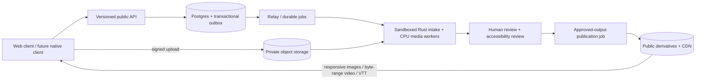

# ADR 0001 — A media-capable knowledge platform

Status: accepted for the current implementation; production release gates below
are not yet satisfied. This decision extends the engineering specification.

## Product and operational shape

Unstuck is a platform with a web client, a public domain API, asynchronous media
and evidence processing, durable records, and moderation. The first client is
web-based. A future native client should reuse the same public contracts and
media delivery, rather than reimplementing identity or evidence rules.

Keep Next.js and TypeScript as replaceable presentation tools. They do not own
identity, publication, evidence state, source media, or the system of record.
Changing the frontend framework would not, by itself, solve persistence,
accessibility, unsafe uploads, or reliable playback.

Start with a modular monolith plus independently runnable workers, following the
existing specification. Do not introduce Kubernetes, a service mesh, or a custom
player before demonstrated operational needs justify their cost. Postgres is the
required source of truth; Redis is transport/cache, never the durable authority.

The diagram is the intended deployed architecture. The entry core now has a
transactional Postgres adapter; see [ADR 0002](0002-durable-core.md). The remaining
persistent workflows, real storage, relay/queues, Rust intake and the full encoding
pipeline remain unimplemented.
The memory repository is a development adapter. `APP_ENV=production` now refuses
memory repositories and fake object storage; this is a startup guard, not proof
that a real adapter is production-ready.

## Rendering and client boundaries

- Server-render written entries, descriptions, context, and transcripts. They
  remain readable without executing application JavaScript.
- Hydrate interaction where needed: bookmarks, draft controls, media consent,
  quality selection and playback recovery. Do not send complete entry bodies,
  evidence, context and media manifests to a discovery card that does not use them.
- Treat HTTP response bodies as unknown. Validate them using canonical Python-
  exported JSON Schemas. Generate TypeScript bindings from those schemas and fail
  CI on drift. Older readers discard additive response fields, while media stays
  strictly versioned. Types alone cannot validate data at a network boundary.
- Bound JSON responses (512 KiB for one entry, 2 MiB for a feed), including streamed
  responses without Content-Length. Upstream outages must not turn into a 404 or
  silently become demonstration content.
- Validate media separately from the written entry. Invalid, unavailable or
  unapproved media has a readable fallback without suppressing the entry.

The discovery feed still filters only its loaded page and hydrates a client
island. Server pagination, database search, per-route bundle analysis and further
island decomposition remain work; a small card payload is not a completed
infinite-feed architecture.

## Media publication and storage

Uploads go directly to private object storage. The API admits and finalizes an
upload; it does not decode images, proxy video bytes, or run ffmpeg in a request.
Workers must parse untrusted bytes only through the specified intake boundary.

Processing readiness and human approval are separate. Approval records an
immutable snapshot of the approved manifest and output mapping, then writes a
`media.publish` job. The job checks approval before copying any bytes and never
grants approval itself. Extra OCR/scan files are not published with an image or
video. Takedown clears delivery metadata and public copies, and a late publication
job cannot undo it. Retry and takedown tests currently prove this in the memory
adapter only; cross-worker leases, Postgres transactions and CDN invalidation
must receive equivalent real-adapter tests.

Real uploads must use write-once/versioned originals and content-addressed or
revisioned derivatives. Finalization must bind to an exact object version and a
verified checksum. A source edit or processing revision must not overwrite an
asset served with immutable caching. The current fake storage does not provide
these durability or integrity properties.

Public media manifests expose only `/m/{media-id}/{filename}` delivery paths,
never original uploads, private bucket keys, arbitrary embeds, or account IDs.
A configured bare HTTPS CDN origin may prefix those paths. The edge must serve
only the public bucket; it must not forward `/m/` misses to the private bucket.

## Photos and videos

For the current 60-second clip scope:

- Photos: immutable worker-generated JPEG/WebP/AVIF variants, at most 1600 pixels
  on either edge and 1 MiB per variant. Native `picture`, `srcset`, `sizes`, stable
  intrinsic dimensions, lazy loading, asynchronous decode, and useful alt text.
- Video: portable H.264/AAC MP4 at approximately 360p and 720p, capped at 720p-
  equivalent decoded pixels in either landscape or portrait orientation. The
  encoder still needs implementation and device playback tests; MIME metadata
  is not proof of a codec. Delivery contracts cap a rendition at 20 MiB.
- Use native controls first, `playsInline`, no autoplay, and `preload="none"`.
  Browsers may treat preload as a hint. In light reading, the application omits
  image/video/source/poster/track elements until explicit consent, instead of
  relying on CSS hiding or preload hints to prevent requests.
- Start with the small video rendition. Let the reader choose a larger one with
  its transfer size shown. Quality changes preserve position and pause playback.
  Pause hidden-page playback; do not automatically resume it.
- Video with audio requires a reviewed VTT caption track. Every video requires a
  descriptive transcript, including relevant visual events. An audio-described
  rendition is supported. A transcript does not replace every WCAG audio-
  description requirement: manual review must decide whether an additional
  described track is needed.
- If an image or video fails, retain descriptions and the transcript and offer
  recovery. Do not fail the whole article.

Add adaptive HLS/DASH with a lazily loaded player adapter when longer video,
measured rebuffering, or explicit device requirements justify it. Keep a portable
MP4 fallback. Do not bundle an adaptive-streaming library into every text page
for a feature the current short-clip scope does not need.

CDN release checks must cover byte-range requests, `Content-Type`, `Content-Length`,
CORS for caption tracks, MIME sniffing protection, immutable caching of revisioned
assets, denied access to private objects, and purge/revocation latency. The web
app does not implement a pretend object-store proxy in their place.

## Accessibility and performance acceptance

Target WCAG 2.2 AA with manual keyboard, screen-reader, zoom/reflow, caption and
visual-description review. Automated axe checks are a useful subset, not a
conformance certificate. Test meaningful content and recovery with JavaScript
unavailable. Respect reduced motion and user/network reading preferences. Mobile
navigation must trap and restore focus, close with Escape, and make the obscured
content inert.

Current regression gates cover canonical schema drift, bounded JSON, private
media suppression, alt text, reviewed captions, transcripts, small renditions,
no autoplay, lite-mode consent, native media errors, SSR reading and startup
refusal of development storage in production. CI adds Chromium checks for actual
media request suppression, phone reflow, focus and JavaScript-disabled reading.
These are synthetic media fixtures, not codec, throughput or CDN tests.

The 50 KiB compressed **HTML document** budget is enforced separately from fonts,
CSS, JavaScript and media. This is not a claim that the whole page transfers less
than 50 KiB. CI currently guards representative fixtures; worst-case long-content
fixtures remain a release gate. Establish cold-cache, route-specific script/style budgets and measure
LCP, INP, CLS and playback startup on representative low-end phones before beta.
Cross-browser playback (Safari/iOS, Chrome/Android and Firefox), actual codecs,
assistive technology and p95 load targets remain release gates.

## Implementation order before a public pilot

1. Finish the remaining Postgres repositories and outbox delivery, then complete
   identity integration and retention cleanup. Core transactions, migrations,
   retry keys and session reads are implemented. Prove restore from backup.
2. Real private/public storage, immutable upload versions, sandboxed intake,
   metadata stripping, real codecs, caption review and takedown/purge behavior.
3. Connect the composer, uploads, reports and moderation to those services. Keep
   authorization and state decisions in the domain API.
4. Exercise native device playback, manual accessibility, realistic slow-network
   profiles and concurrent load; then publish measured limits and operational
   dashboards. Scale workers or introduce additional services in response to
   observed bottlenecks.

## Primary references

- [W3C: Making audio and video accessible](https://www.w3.org/WAI/media/av/)
- [W3C: Captions](https://www.w3.org/WAI/media/av/captions/)
- [MDN: video element](https://developer.mozilla.org/en-US/docs/Web/HTML/Reference/Elements/video)
- [Next.js: Server and Client Components](https://nextjs.org/docs/app/getting-started/server-and-client-components)
- [Ajv: JSON Schema](https://ajv.js.org/json-schema)
